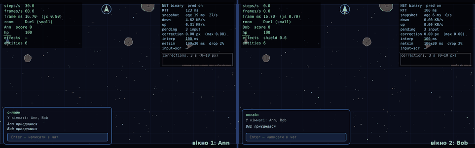
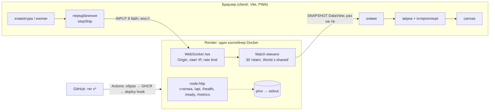
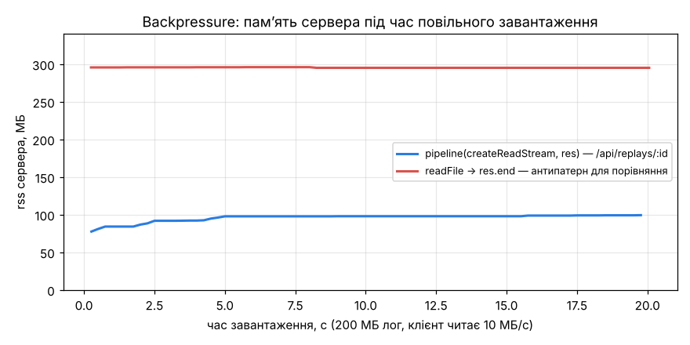
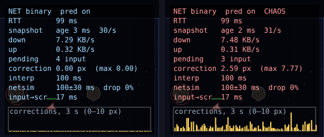
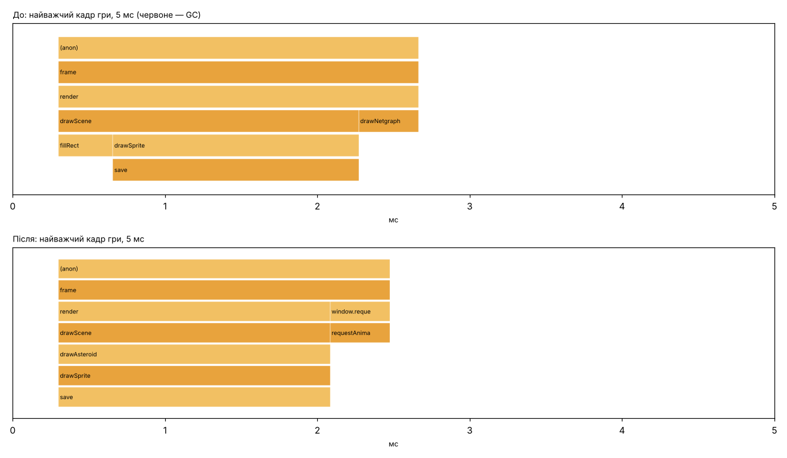
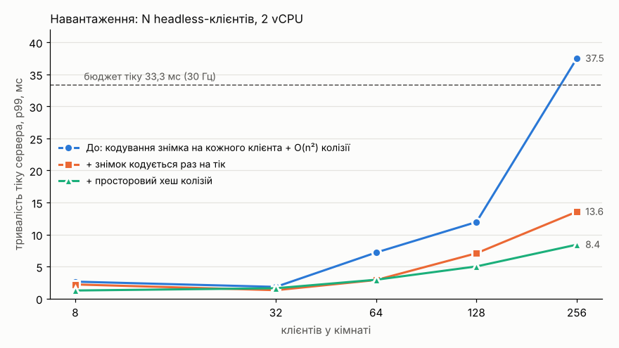
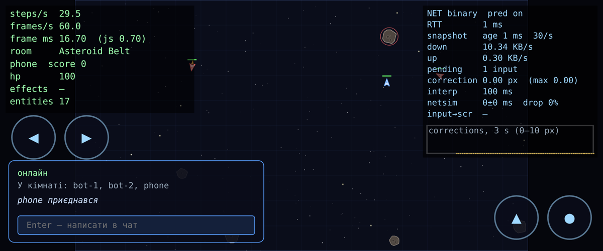

# Spacefight

[](../../actions/workflows/ci.yml) [](../../actions/workflows/deploy.yml)

Мультиплеєрна браузерна гра з космічними кораблями: кімнати, чат, астероїди, бонуси. Сервер на Node рахує світ 30 разів на секунду, браузер передбачає свій корабель і плавно малює чужі. Проєкт курсу «JavaScript: мультиплеєрна гра», зібраний за 8 лабораторних (теги `lab-01` … `lab-08`, реліз `v1.0.0`).

**▶ Грати: <https://spacefight.onrender.com>** _(⚠ заміни на адресу свого сервісу Render після першого деплою — див. [Lab 08 → Деплой](#деплой-за-тегом-v))_
**🎬 Відео (3–5 хв):** _⚠ посилання на відео_



_Два вікна в одній кімнаті, штучна затримка 100 ± 30 мс і 2% втрат пакетів. Праворуч у кожному вікні — netgraph._

## Як грати

1. Відкрий посилання, введи ім’я пілота й обери кімнату (Classic — до 4 гравців, Asteroid Belt, Duel — 1 на 1). Другий гравець відкриває те саме посилання на іншому комп’ютері чи телефоні й обирає ту саму кімнату.
2. **Клавіатура:** `W`/`↑` — газ, `A D`/`← →` — поворот, `Space` — стрільба (затиснути), `Enter` — чат.
   **Телефон:** екранні кнопки ◀ ▶ ▲ ●. Гру можна встановити: «Додати на головний екран» (Android/Chrome — «Встановити застосунок»).
3. Збивай астероїди (+10) і кораблі суперників (+100). Бонуси: щит, швидка стрільба, самонавідні кулі.
4. Праворуч угорі — netgraph: **RTT** до сервера, трафік, поправки передбачення.

## Як це влаштовано



- `shared/` — симуляція (детермінована: власні `sin/cos/atan2`), протокол на Zod і бінарний кодек. Той самий код крутиться на сервері (авторитетний світ) і в браузері (передбачення свого корабля).
- `server/` — один процес Node: HTTP + WebSocket, кімнати з матчами в пам’яті, логи матчів, метрики.
- `client/` — Vite-застосунок: цикл з фіксованим кроком, рендер canvas, лобі, чат, PWA.

**Чому гравці однієї кімнати сидять в одному процесі.** Стан матчу — це об’єкти в пам’яті процесу, які змінюються 30 разів на секунду: позиції, кулі, черги input кожного гравця. Якби двоє гравців кімнати потрапили в різні процеси (наприклад, балансувальник розкидав з’єднання по двох контейнерах), кожен процес рахував би свій світ і гравці не бачили б одне одного. Синхронізувати світ між процесами через Redis чи БД на кожному тіку — це +мілісекунди мережі на кожен крок і складність, яка не потрібна грі такого розміру. Тому сервіс має один екземпляр, а якщо колись знадобиться масштабування — шардинг за кімнатою (усі з’єднання кімнати → один процес, «липкий» роутинг за id кімнати), а не за з’єднанням.

## Цифри

**Протокол (Lab 05), 4 гравці, 30 Гц:**

| Кодек                 | Байт/знімок | KB/s на клієнта ↓ | Input, байт |
| --------------------- | ----------: | ----------------: | ----------: |
| JSON                  |        3611 |             106.1 |          71 |
| Бінарний (`DataView`) |         606 |          **17.7** |       **8** |

**Сервер під навантаженням (Lab 07), тривалість тіку p99, мс** (бюджет 33,3 мс; 2 vCPU):

| Клієнтів в одній кімнаті                    | 8   | 32  | 64  | 128  | 256      |
| ------------------------------------------- | --- | --- | --- | ---- | -------- |
| До оптимізацій                              | 2,6 | 1,8 | 7,2 | 12,0 | **37,5** |
| Після (знімок раз на тік + просторовий хеш) | 1,3 | 1,6 | 2,9 | 5,0  | **8,4**  |

**Клієнт (Lab 07), 8 ботів:** JS-робота кадру p99 2,1 мс, найдовша пауза GC ≤ 10 мс, 60 fps без пропусків.

**Скільки гравців тримає один процес.** За заміром Lab 07 одна кімната на 256 клієнтів укладається в 8,4 мс тіку (p99) з 33 — тобто процесор не є межею для наших кімнат по 4–8 гравців. Межа — **трафік**: кожен гравець отримує ~18 KB/s (при 4 гравцях у кімнаті; більше сутностей — більші знімки), 256 гравців — ~90 МБ/с. На безкоштовному інстансі Render (за тарифом 0,1 CPU і 512 МБ) — **оцінка, не замір: ~40–60 гравців** (10–15 кімнат по 4), далі ростуть `spacefight_tick_ms_p99` і `spacefight_event_loop_utilization` у `/metrics`. Конфіг обмежує це явно: `MAX_ROOMS` × `MAX_PLAYERS_PER_ROOM`, коли все зайнято — `/ready` віддає 503.

## Обмеження, що лишились (і чому)

- **Один процес — без горизонтального масштабування.** Причина вище; для курсового проєкту один екземпляр простіший і чесніший за напівготовий шардинг.
- **Безкоштовний Render засинає через 15 хв без запитів**, перший вхід після сну — ~30–60 с холодного старту. Платний інстанс цього не має.
- **Стан не переживає перезапуск:** деплой або падіння завершують матчі (гравці отримують `shutdown` і повертаються в лобі). Зберігати світ, що змінюється 30 разів на секунду, у БД немає сенсу; логи матчів (NDJSON) живуть у контейнері й зникають разом з ним.
- **Немає акаунтів і античиту поза сервером:** ім’я — будь-який рядок; захист — авторитетний сервер, кредити input, rate limit, Origin і ліміт з’єднань з IP.
- **Регіон один** (обирається при створенні сервісу; для України найближчий — Frankfurt): гравцю з іншого континенту RTT буде 150+ мс; передбачення ховає це для свого корабля, але чужі кораблі показуються з затримкою інтерполяції.
- **Офлайн не грається:** PWA кешує оболонку, але світ рахує сервер.
- `/metrics` відкритий (для лаби зручно); у справжньому продакшні його закривають мережею або токеном.

## Запуск

```bash
nvm use            # Node 22 (.nvmrc), потрібно ≥ 22.9
npm install        # ставить усі workspaces: shared/, client/, server/
npm run dev        # сервер (:3000, node --watch) + Vite (:5173), відкрити http://localhost:5173
```

Production-режим (один процес, сервер сам віддає зібраний клієнт):

```bash
npm run build      # client/dist
npm start          # http://localhost:3000
```

Docker (Lab 8):

```bash
docker build -t spacefight:local --build-arg GIT_SHA=$(git rev-parse HEAD) .
docker run --rm -p 3000:3000 spacefight:local        # http://localhost:3000
sh scripts/docker-check.sh spacefight:local          # розмір, не root, HEALTHCHECK, docker stop
```

`npm run typecheck` — TypeScript під `strict` для всіх пакетів, `npm test` — Vitest у `shared/` (з покриттям), `server/` і `client/`, `npm run e2e` — Playwright (два браузери в одній кімнаті), `npm run lint` перевіряє код Biome, `npm run format` автоматично виправляє знайдене. Конфіг сервера береться з оточення (див. `server/.env.example`).

**Керування:** `W`/`↑` для газу, `A D`/`← →` для повороту, `Space` для стрільби (затиснути), `Enter` для чату.

Порядок: завантаження ассетів → лобі (ім’я + кімната) → гра + чат кімнати.

```txt
shared/   спільне для браузера й Node (Lab 5): симуляція, протокол, бінарний кодек
client/   Vite-застосунок: цикл, рендер, лобі, передбачення/інтерполяція, netgraph
server/   Node: HTTP + WebSocket, кімнати, логи матчів (Lab 4), авторитетний Match (Lab 5)
docs/     скриншоти, графіки, сирі дані замірів
```

> З Lab 6 увесь код — TypeScript: файли `*.js` із розділів Lab 1–5 тепер `*.ts` з тими самими назвами. Сервер Node запускає `.ts` напряму (type stripping), клієнт збирає Vite.
>
> З Lab 4 клієнтський код переїхав у `client/`, а з Lab 5 симуляція — у `shared/src/sim/` (обидва рази через `git mv`, історію збережено). Локальний режим Lab 1–3 (уся гра в браузері) лишився: його вмикає будь-який `?exp=…` або `?offline=1`.

---

## Lab 01 — Event loop і ігровий цикл

> Нижче описано стан на тезі `lab-01`. З Lab 2 функція `integrate(ship, command, dt)` розділилася на `Ship.control(command, dt)` (поворот, газ, тертя, обмеження швидкості) і `Entity.update(dt)` (рух). Фізика від цього не змінилась: експеримент `?exp=fixed&auto=1` дає ту саму позицію `964.7644576798393, 472.5317580176354`. З Lab 5 симуляція використовує власні детерміновані `sin`/`cos` і нормалізує кут, тому той самий експеримент дає `964.7644576798375, 472.5317580176352`: різниця в 13-му знаку. Головне не змінилося: з фіксованим кроком результат однаковий за будь-якого fps.

### Що зроблено

| Вимога                                                                                                | Де в коді                                                                       |
| ----------------------------------------------------------------------------------------------------- | ------------------------------------------------------------------------------- |
| Ігровий цикл на `requestAnimationFrame` + акумулятор із clamp 0.25 с, `alpha` для рендеру             | `client/src/loop.js` → `createLoop({ step, simulate, render })`                 |
| Лічильники steps/s, frames/s, frame ms у HUD                                                          | `createStats()` у `client/src/loop.js`, `drawHud` у `client/src/render/draw.js` |
| Клавіатура як замикання з `isDown` і `justPressed` (+`consume`, ігнор `e.repeat`, скидання на `blur`) | `client/src/input.js` → `createInput()`                                         |
| Чиста фізика `integrate(ship, command, dt)` без DOM                                                   | `client/src/sim/ship.js`                                                        |
| Арена з «загортанням» країв; lerp, який не тягне корабель через усю арену                             | `client/src/sim/arena.js`                                                       |
| Інтерполяція `previous → current` і `lerpAngle` (коротким шляхом по колу)                             | `client/src/render/draw.js`                                                     |
| Canvas з урахуванням `devicePixelRatio`, ресайз                                                       | `client/src/render/canvas.js`                                                   |
| Сітка й зоряне поле, щоб було видно рух                                                               | `client/src/render/draw.js`                                                     |
| Експерименти M4 (вмикаються параметром URL, основний код лишається чистим)                            | `client/src/dev/experiments.js`                                                 |

### Рішення, закладені під наступні лаби

- **`client/src/sim/` не має жодних залежностей від браузера**: немає DOM, `Date.now()` чи `Math.random()`. У Lab 5 ця папка без змін переїде в `shared/` і запускатиметься на сервері.
- **Симуляція отримує команду `{ thrust, turn, fire }`, а не клавіатуру.** Перетворення клавіш на команду робить `readControls()` у `input.js`. Саме цю команду в Lab 5 клієнт надсилатиме на сервер.
- **Арена має фіксований розмір у світових координатах (1600×900)** і вписується у вікно під час рендеру. Тому в мультиплеєрі гравці з різними моніторами житимуть в одному світі.
- **`integrate` змінює об’єкт на місці**, а всі поля корабля створюються одразу й в одному порядку. Так не створюється сміття для GC і зберігається одна «форма» об’єкта (Lab 7).
- `createStats()` зберігає останні 600 інтервалів кадрів у `Float64Array`. Звідти в Lab 7 рахуватимуться p50/p95/p99.

### Чому фізика має саме такі параметри (M2)

`turnRate 3.6 рад/с` дає повний оберт приблизно за 1.7 с: корабель достатньо швидко розвертається, щоб ухилятися, але ним ще можна прицілитись. `thrust 320 px/с²` разом із `maxSpeed 420 px/с` означає, що арену шириною 1600 корабель перетинає приблизно за 4 с. `drag 0.55/с` потрібен, щоб без газу корабель плавно зупинявся і не дрейфував вічно. Інакше в маленькій арені з «загортанням» ним важко керувати. Обмеження швидкості потрібне, щоб корабель не розганявся нескінченно (для колізій у Lab 2).

---

### M4 — три навмисні поломки

Усі поломки вмикаються параметром URL, наприклад `http://localhost:5173/?exp=block`. Звичайна гра модуль експериментів не завантажує. Через 10 с у консоль виводиться статистика інтервалів кадрів (mean/std/min/p50/p95/max).

| Параметр               | Що ламає                                                          |
| ---------------------- | ----------------------------------------------------------------- |
| `?exp=block`           | busy-wait 100 мс у `render` кожен 60-й кадр                       |
| `?exp=interval`        | `setInterval(frame, 16)` замість rAF                              |
| `?exp=variable&auto=1` | змінний крок: один `simulate(dt)` на кадр + автопілот             |
| `?exp=fixed&auto=1`    | нормальний фіксований крок + той самий автопілот (для порівняння) |

**Середовище замірів:** Chromium (Playwright), Linux, віртуальний дисплей 60 Гц, вікно 1280×720. Числа нижче зняті саме там. Дефенд варто повторити на своєму моніторі: якщо він 120/144 Гц, frames/s буде відповідно 120/144, а steps/s однаково 60.

#### Еталон: нормальний цикл (rAF + фіксований крок)

| steps/s | frames/s | інтервал кадру mean ± std | p95     | max                                    |
| ------- | -------- | ------------------------- | ------- | -------------------------------------- |
| 60.0    | 60.0     | 16.69 ± 0.68 мс           | 16.8 мс | 33.3 мс (один пропущений кадр за 10 с) |

#### Експеримент 1 — блокуючий цикл у кадрі (`?exp=block`)

```js
if (frame % 60 === 0) {
  const t = performance.now()
  while (performance.now() < t + 100) {}
}
```

|             | steps/s  | frames/s | інтервал mean ± std  | max          |
| ----------- | -------- | -------- | -------------------- | ------------ |
| Норма       | 60.0     | 60.0     | 16.69 ± 0.68 мс      | 33.3 мс      |
| Блок 100 мс | **60.0** | **55.1** | 18.05 ± **10.55** мс | **100.1 мс** |

**Що бачить гравець:** раз на секунду гра «замерзає» приблизно на 0.1 с, а потім корабель стрибком опиняється далі. HUD показує, що frames/s падає до ~55 (за секунду втрачається близько 6 кадрів, бо 100 мс ≈ 6 × 16.7), а frame ms у цей момент сягає 100. **steps/s при цьому лишається рівно 60:** після блоку акумулятор отримує 0.1 с і в наступному кадрі виконує ~6 кроків симуляції поспіль. Час гри не відстає, проте картинка смикається.

**Чому це неможливо обійти з JavaScript у тому самому потоці.** JS у вкладці має один потік і один стек викликів. Event loop бере наступну задачу, виконує rAF і малює кадр лише тоді, коли стек порожній. Поки `while` крутиться, стек зайнятий, і нічого іншого не відбувається: ні paint, ні обробник клавіш, ні таймер, ні мікрозадачі. Функцію, що вже виконується, ніщо не перериває (run-to-completion). `await`, `setTimeout` чи проміс усередині тут не допоможуть, бо вони лише кладуть роботу в чергу, а черги обробляються після того, як звільниться стек. Позбутися блокування можна тільки двома способами: не робити такої роботи в головному потоці (поділити її на шматки між кадрами) або винести її в окремий потік, тобто Worker (Lab 7).

#### Експеримент 2 — `setInterval(frame, 16)` замість rAF (`?exp=interval`)

|                   | frames/s | інтервал mean ± std | min … max          | p95     |
| ----------------- | -------- | ------------------- | ------------------ | ------- |
| rAF               | 60.0     | 16.69 ± 0.68 мс     | 16.5 … 33.3 мс     | 16.8 мс |
| `setInterval(16)` | **62.5** | 16.00 ± 0.48 мс     | **13.2 … 18.4 мс** | 16.7 мс |

**Фонова вкладка на 5 с** (вимірювання за 5.5 с: 5 с у фоні + 0.5 с після повернення):

|                   | кроків симуляції за 5.5 с (норма ≈ 330)                                    | найдовший інтервал кадру |
| ----------------- | -------------------------------------------------------------------------- | ------------------------ |
| rAF               | **130**: rAF майже зупинився (~1 кадр/с), clamp 0.25 с не дав надолужувати | **1016.7 мс**            |
| `setInterval(16)` | **339**: таймер працював далі, як ні в чому не бувало                      | 46.4 мс                  |

**Висновки:**
1. **Частота не збігається з дисплеєм.** 16 мс ≠ 16.67 мс, тому таймер спрацьовує 62.5 раза на секунду, а екран оновлюється 60. Приблизно 2–3 рази на секунду два «кадри» потрапляють між двома paint: один рендер виконується даремно, а рух стає нерівним (judder). Інтервали «пливуть» від 13 до 18 мс, бо таймер є звичайною задачею в черзі і чекає, доки звільниться стек, і нічого не знає про vsync. rAF натомість викликається браузером як крок рендерингу безпосередньо перед paint.
2. **Фон.** rAF у фоновій вкладці браузер призупиняє (тут ~1 Гц, у звичайному desktop Chrome на прихованій вкладці він зупиняється повністю). Гра «стає на паузу» і не витрачає CPU. `setInterval` продовжує працювати й ганяти симуляцію та рендер, хоча кадрів ніхто не бачить. Chrome урізає таймери прихованих вкладок до ≥1 с лише з часом, тобто поведінка непередбачувана.
3. Кроків симуляції в обох варіантах ~60/с, бо акумулятор однаково рахує реальний час. Цикл з фіксованим кроком захищає фізику навіть від поганого джерела кадрів, але не робить картинку плавною.

_Примітка щодо середовища:_ у цьому браузері Playwright не генерував `visibilitychange` під час перемикання вкладок, проте rAF однаково був пригальмований до ~1 кадру/с. У звичайному Chrome варто повторити: перемкнутися на іншу вкладку на 5 с і повернутися, після чого в консолі видно звіт.

#### Експеримент 3 — змінний крок замість фіксованого (`?exp=variable&auto=1`)

Автопілот затискає **газ + поворот праворуч** на 5 с часу симуляції, після чого виводить позицію корабля. Старт у точці (800, 450), кут −90°. Throttling CPU 6× вмикався через DevTools Protocol (`Emulation.setCPUThrottlingRate`), так само як у DevTools → Performance → CPU 6× slowdown.

| Цикл                | Запуск                   | час симуляції | x                     | y                     |
| ------------------- | ------------------------ | ------------- | --------------------- | --------------------- |
| **Фіксований** 1/60 | без throttling           | 5.000000      | **964.7644576798393** | **472.5317580176354** |
| **Фіксований** 1/60 | CPU 6×                   | 5.000000      | **964.7644576798393** | **472.5317580176354** |
| Змінний             | без throttling, запуск 1 | 5.016467      | 961.7787              | 478.5036              |
| Змінний             | без throttling, запуск 2 | 5.016567      | 964.1418              | 473.3698              |
| Змінний             | CPU 6×                   | 5.016467      | 968.4876              | 476.9332              |

**Висновок:** з фіксованим кроком позиція збігається **до останнього біта** (ті самі 300 кроків по 1/60 с), хоча під throttling окремі кадри тривали до 66.7 мс. Зі змінним кроком розбіжність становить до **~7 px** між запусками, причому навіть два запуски без throttling на одній машині дають різний результат. Причина в тому, що інтегрування Ейлера з поворотом і тертям залежить від розміру кроку: ті самі 5 с, поділені на інші шматки, дають іншу траєкторію. Розмір шматків визначається тим, коли event loop дійшов до rAF, тобто навантаженням машини. Крім того, «рівно 5 с» досягти неможливо, бо останній кадр завжди проскакує межу.

**Чому це важливо:** у Lab 5 клієнт і сервер повинні отримувати однаковий результат з однакових команд (client-side prediction). Зі змінним кроком вони роз’їдуться вже за кілька секунд. Тому симуляція завжди крокує по 1/60 с, а плавність забезпечує інтерполяція в рендері.

Після експериментів код гри лишається незмінним: усі поломки ізольовані в `client/src/dev/experiments.js` і за замовчуванням вимкнені.

---

### Чекліст Lab 01

- [x] Vite, `"type": "module"`, Biome, `.nvmrc`
- [x] `createLoop`: rAF + clamped accumulator; steps/s, frames/s, frame time у HUD
- [x] `createInput`: замикання з `isDown` і `justPressed`
- [x] Чиста `integrate(ship, input, dt)`; wrap-around; `sim/` без DOM
- [x] Інтерполяція з правильним `lerpAngle`; DPR-aware canvas з ресайзом
- [x] Експерименти 1–3 з числами та поясненням через event loop
- [x] Тег `lab-01`

---

## Lab 02 — Об’єкти, `class`, `this`: модель сутностей

### Що зроблено

| Вимога                                                                                                                                         | Де в коді                                                          |
| ---------------------------------------------------------------------------------------------------------------------------------------------- | ------------------------------------------------------------------ |
| `Vector2`: чисті методи `add/sub/scale/length/normalize/rotate/dot/fromAngle` + `*InPlace` для гарячого шляху                                  | `client/src/sim/vector.js`                                         |
| `Entity` (`id`, `pos`, `vel`, `angle`, `radius`, `kind`, `alive`, `update`), приватний лічильник `static #nextId` / `#id`                      | `client/src/sim/entity.js`                                         |
| `Ship extends Entity` (один рівень), `#hp` + `get hp()`, `fire()` з носа з успадкованою швидкістю                                              | `client/src/sim/ship.js`                                           |
| `Bullet` (TTL 1.1 с), `Asteroid` (дрейф і обертання), `Explosion` (18 частинок, 0.8 с)                                                         | `client/src/sim/entity.js`                                         |
| `World` над `Map<id, Entity>`: `spawn`, `despawn` (позначка) + `#sweep` наприкінці кроку, `[Symbol.iterator]`, `*ofKind`, `step(dt, commands)` | `client/src/sim/world.js`                                          |
| Коло-коло колізії окремою системою: генератор пар `findCollisions` + правила `resolveCollisions`                                               | `client/src/sim/collision.js`                                      |
| Шкода, вибух, респаун через 2 с у безпечній точці, рахунок (астероїд +10, корабель +100) у HUD                                                 | `collision.js`, `world.js`, `main.js`                              |
| Homing і pickup через композицію                                                                                                               | `client/src/sim/components.js`                                     |
| Демонстрація бага з `this`                                                                                                                     | `client/src/dev/experiments.js` (`?exp=this-bug`, `?exp=this-fix`) |

**Що в грі:** ваш корабель (синій), корабель-мішень без пілота (червоний; на ньому видно шкоду, вибух і респаун), 6 астероїдів (кожен 4-й є «мисливцем» з homing і має червоний обрис), pickup раз на ~6 с: `S` щит 5 с, `R` швидка стрільба 6 с, `H` самонавідні кулі 8 с.

**Порядок одного кроку `World.step`:** зберегти попередній стан (для інтерполяції) → команди кораблям і постріли → система homing → `update` усіх сутностей + загортання → колізії → респаун і підтримка кількості астероїдів/pickup → `#sweep` мертвих → додати сутності, заспавнені під час кроку (щоб не змінювати `Map` посеред обходу).

**Під наступні лаби:** `sim/` і далі не залежить від DOM. Перевірено в Node: 3600 кроків зі стрільбою, колізіями й респауном дають однаковий результат при двох запусках з одним seed. Випадковість іде тільки через seeded `mulberry32` (`sim/random.js`). Команди надходять у `World.step` як `Map<shipId, command>`, саме так їх передаватиме сервер у Lab 5.

### Баг із `this` (`?exp=this-bug`)

`Ship.fire()` читає `this.solid`, `this.cooldown`, `this.pos`. Наївне підключення до клавіатури:

```js
window.addEventListener('keydown', ship.fire) // передали ФУНКЦІЮ, а не виклик ship.fire()
```

`this` визначається **в момент виклику**, а не тим, «чий це метод». Слухач викликає браузер, і він підставляє `this = window` (елемент, на якому висить слухач). Вивід у консолі (`?exp=this-bug`):

```
[this-bug] голий виклик: TypeError Cannot read properties of undefined (reading 'solid')
[this-bug] this у setTimeout === window: true
[this-bug] this у слухачі === window: true
```

- **Слухач / `setTimeout(ship.fire)`:** `this === window`, `window.solid` дорівнює `undefined`, тому `!this.solid` дає `true` і `fire` **мовчки повертає `null`**. Помилки немає, але й пострілу теж. Це найпідступніший варіант бага. (Цікава деталь: у браузері таймер теж кличе колбек з `this = window`, а не `undefined`.)
- **Голий виклик `const f = ship.fire; f()`:** правило default binding, код класу завжди strict, тому `this === undefined` і виникає `TypeError`.

**Фікс і альтернативи** (`?exp=this-fix`, клавіша `F` → `[this-fix] fire() → куля #9`):

| Спосіб                      | Як                                               | Мінус                                                                                                   |
| --------------------------- | ------------------------------------------------ | ------------------------------------------------------------------------------------------------------- |
| Стрілка-обгортка            | `addEventListener('keydown', () => ship.fire())` | нова функція при кожній реєстрації; щоб зняти слухач, її треба десь зберегти                            |
| `bind` (використано в демо) | `const fire = ship.fire.bind(ship)`              | так само окрема функція; `bind` не можна «перебити» пізніше через `call`/`bind`                         |
| Поле-стрілка в класі        | `fire = () => { … }`                             | своя копія функції в **кожному** екземплярі, а не одна на прототипі: для 1000 сутностей це 1000 функцій |

**Що вибрано в грі.** Клавіатура взагалі не викликає `fire`. `readControls()` перетворює клавіші на дані `{ thrust, turn, fire }`, а `World.step` сам викликає `ship.fire()` через крапку (implicit binding, `this = ship`). Причин дві: постріл має відбуватися всередині фіксованого кроку симуляції, а не в момент події клавіатури (Lab 1), і в Lab 5 ця сама команда прийде з мережі, де ніякого слухача немає.

### Чому композиція, а не дерево класів

**Як виглядала б ієрархія.** Спочатку все просто: `Entity → MovingEntity → Ship / Bullet / Asteroid`. Потім треба додати:

- **homing** для кулі _і_ для астероїда. Доведеться робити `HomingBullet extends Bullet` і `HomingAsteroid extends Asteroid` з однаковим скопійованим кодом наведення або вставляти `HomingEntity` у середину дерева (`MovingEntity → HomingEntity → Bullet`). Тоді «наводитися» вмітимуть _усі_ кулі, і доведеться ще й вимикати це прапорцем.
- **pickup**, який стоїть на місці, бере участь у колізіях, але не є кораблем. Він не `MovingEntity`, тож з’являється друга гілка `Entity → StaticEntity → Pickup`, а колізії (спільні для обох гілок) знову доводиться піднімати в корінь.
- **Ефекти pickup змінюються під час гри:** куля стає самонавідною, коли гравець підібрав `H`. Клас об’єкта після `new` не змінити, тому довелося б створювати _іншу_ кулю іншого класу.

Кожна нова фіча вимагає перебудовувати дерево. Якщо поведінки комбінуються (homing × bullet/asteroid, щит × швидка стрільба), кількість класів росте як добуток.

**Що зроблено.** Наслідування лише одного рівня (`Ship/Bullet/Asteroid/Explosion extends Entity`) для того, що в сутності є завжди (позиція, рух, TTL). Усе додаткове реалізовано **компонентами-полями** з даними, які обробляє окрема **система**:

```js
bullet.homing = homing({ targets: ['asteroid', 'ship'], turnRate: 4, range: 380 }) // куля з H
asteroid.homing = homing({ targets: ['ship'], turnRate: 0.7, range: 450 }) // «мисливець»
const p = createPickup({ x, y, effect: 'shield' }) // звичайний Entity + p.pickup = { effect }
// система: for (const e of world) if (e.homing) … — їй байдуже, куля це чи астероїд
```

**Чому саме так (поля-компоненти, а не міксини чи повний ECS):**

1. **Поведінку можна додати або зняти під час гри:** `bullet.homing = …` або `= null`, без нового класу.
2. **Будь-яка комбінація без нових класів:** homing на кулі, на астероїді, а за потреби й на кораблі.
3. **Компоненти є звичайними даними** (`{ targets, turnRate, range }`, `{ effect }`), тому їх легко серіалізувати для мережевих знімків у Lab 5. Функції в стані довелося б відновлювати.
4. **Одна «форма» об’єктів:** `homing` і `pickup` оголошені в конструкторі `Entity` як `null`, тож усі сутності мають однаковий набір полів у тому самому порядку (це знадобиться в Lab 7, hidden classes). Міксини через `Object.assign` додавали б поля після створення об’єкта й плодили б різні форми.
5. Повний ECS (масиви компонентів, сутність як індекс) для шести видів сутностей є надлишковим. Це Stretch і Lab 7.

**Ціна:** системи перевіряють `if (e.homing)` на кожній сутності, а правила колізій зібрані в одному `switch` за парою `kind`. Для нашої кількості сутностей це дешево й легко читається.

### Досліди в консолі (notes §1–3)

- `Object.create(a)`: `b.hello` дає `1`, `b.hasOwnProperty('hello')` дає `false`, після `a.hello = 2` маємо `b.hello === 2`. Метод не копіюється, а знаходиться пошуком по прототипу. Тому тисяча куль ділить один `Bullet.prototype.update`.
- `const m = a.m; m()` дає `undefined`, а `m.call(a)` дає `a` (див. баг вище).
- `{1:'x'}` перетворює ключ на рядок `'1'`, а в `Map` ключі `1` і `'1'` різні. Тому id сутностей зберігаються в `Map`.

### Чекліст Lab 02

- [x] `Vector2` з чистими методами; `Entity` з приватним статичним лічильником id; `Ship extends Entity` (один рівень)
- [x] `World` над `Map`, ітерабельний через `[Symbol.iterator]`, `*ofKind`, відкладене видалення через sweep
- [x] `Bullet` (TTL), `Asteroid`, `Explosion` (частинки), pickup; `Ship.fire()`
- [x] Баг із `this` задокументовано з обраним фіксом і альтернативами
- [x] Коло-коло колізії окремою системою; шкода через `#hp`; респаун; рахунок у HUD
- [x] Homing і pickup через композицію; дизайн-запис
- [x] Тег `lab-02`

---

## Lab 03 — Асинхронний JavaScript: ассети, звук, лобі

### Що зроблено

| Вимога                                                                                                                                                           | Де в коді                                                                             |
| ---------------------------------------------------------------------------------------------------------------------------------------------------------------- | ------------------------------------------------------------------------------------- |
| `fetchJson` перевіряє `ok`, кидає `HttpError`; `loadImage` / `loadAudio` / `loadJson` приймають `AbortSignal`                                                    | `client/src/assets/loader.js`                                                         |
| `withRetry`: exponential backoff + jitter, свій таймаут на кожну спробу, **без ретраю на 4xx**, `AbortError` і `SyntaxError`                                     | `client/src/assets/loader.js`                                                         |
| `loadAll`: спрайти через `Promise.all` (критичні), звуки через `Promise.allSettled` (необов’язкові), прогрес по кожному файлу                                    | `client/src/assets/loader.js`                                                         |
| Прогрес-бар на canvas, кнопки «Скасувати» / «Retry»; гра стартує лише після `await loadAll`                                                                      | `client/src/render/loading.js`, `client/src/main.js`                                  |
| Маніфест і спрайтшит з атласом; кораблі, кулі, астероїди, pickup малюються через `drawImage` із source rect                                                      | `client/public/assets/`, `drawSprite` у `client/src/render/draw.js`                   |
| Web Audio: `AudioContext` + `decodeAudioData` під час завантаження, `resume()` після жесту (клік Join / клавіша)                                                 | `client/src/audio.js`                                                                 |
| Шина подій: `world.events` (`EventTarget`) + `CustomEvent` `fired` / `hit` / `exploded` (+ `scored`, `picked`); звук і HUD підписуються ззовні                   | `client/src/sim/world.js`, `collision.js`, `client/src/audio.js`, `client/src/hud.js` |
| `class Lobby extends EventTarget`: `enter` / `refresh` / `join` / `leave`, оновлення кожні 5 с, `AbortSignal.timeout(3000)` на кожен запит, `abort()` при виході | `client/src/lobby/lobby.js`                                                           |
| DOM лобі окремо, лише слухає події; подія `join` перетворена на проміс                                                                                           | `client/src/lobby/lobby-view.js`                                                      |
| `GET /api/rooms` — поки статичний `client/public/api/rooms.json`; «Join» стартує гру з конфігом арени кімнати (розмір, seed, кількість астероїдів)               | `client/public/api/rooms.json`, `createGame` у `client/src/main.js`                   |

**Сим не імпортує ні звук, ні HUD.** Усі імпорти `client/src/sim/`: `entity`, `vector`, `components`, `collision`, `random`, `arena`. Шина є звичайним `EventTarget`, тож у Node вона теж працює: 3600 кроків дали `fired: 225, exploded: 40, scored: 39, picked: 1, hit: 1`. Це знадобиться серверу в Lab 5.

**Чому спрайти через `fetch` → `blob` → `Image`, а не голий `img.src`:** так видно HTTP-статус. 404 не ретраїться, 503 ретраїться. Колбек-API `Image` загорнутий у `new Promise`, тож порядок однаковий і з кешу, і з мережі.

### Sequential `await` vs `Promise.all`

`?exp=loadtime&slow=1`: 6 файлів (атлас, спрайтшит, 4 звуки), кожен із затримкою сервера 150 / 400 / 200 / 250 / 300 / 350 мс (сума 1650 мс, максимум 400 мс). 5 прогонів, кеш обходиться параметром `run=N`. Chromium, localhost.

| Спосіб                                                        | Прогони, мс                  | Медіана     |
| ------------------------------------------------------------- | ---------------------------- | ----------- |
| `for (…) await job()`: наступний стартує після попереднього   | 1694, 1687, 1692, 1691, 1692 | **1692 мс** |
| `await Promise.all(jobs.map(j => j()))`: усі стартують одразу | 411, 409, 411, 412, 410      | **411 мс**  |

**Висновок: різниця в ~4.1 раза.** Послідовний варіант займає приблизно суму затримок (1650 мс + декодування), паралельний — приблизно найдовший файл (400 мс). Справа не в слові `await`, а в тому, **коли стартує** робота: `const a = await loadA(); const b = await loadB()` запускає B тільки після A.

### П’ять головоломок порядку

Кожну перевірено в Chromium тричі, вивід стабільний.

**1. `await` на вже виконаній async-функції**

```js
async function f() {
  log('A')
  await g()
  log('B')
}
async function g() {
  log('C')
}
f()
Promise.resolve().then(() => log('D'))
log('E')
```

Вивід: `A, C, E, B, D`. `g()` виконується синхронно (C) і повертає готовий проміс. Продовження після `await` стає в мікрочергу **раніше**, ніж `.then(D)`, бо `f()` дійшов до `await` до того, як зареєстрували D.

**2. `setTimeout` всередині `.then`**

```js
setTimeout(() => log(1))
Promise.resolve()
  .then(() => {
    log(2)
    setTimeout(() => log(3))
  })
  .then(() => log(4))
log(5)
```

Вивід: `5, 2, 4, 1, 3`. Спершу виконуються вся мікрочерга (2, потім 4 з ланцюжка), потім задачі в порядку постановки: таймер 1 поставили раніше за таймер 3, який з’явився лише всередині `.then`.

**3. `requestAnimationFrame`**

```js
requestAnimationFrame(() => {
  log('raf1')
  setTimeout(() => log('timeout from raf'))
  Promise.resolve().then(() => log('micro from raf'))
  requestAnimationFrame(() => log('raf2'))
})
log('sync')
```

Вивід: `sync, raf1, micro from raf, timeout from raf, raf2`. rAF є кроком рендерингу перед paint. Після кожного rAF-колбека мікрочерга спорожнюється. Таймер — звичайна задача, яка встигає раніше за наступний кадр (~16 мс), а `raf2` виконується вже в наступному кадрі.

**4. Порядок результатів `Promise.all`**

```js
const p = (n, ms) =>
  new Promise((r) =>
    setTimeout(() => {
      log('done ' + n)
      r(n)
    }, ms),
  )
;(async () => {
  const res = await Promise.all([p(1, 30), p(2, 10)])
  log(JSON.stringify(res))
})()
log('started')
```

Вивід: `started, done 2, done 1, [1,2]`. Обидві роботи стартують одразу й завершуються за своїми таймерами (2 швидший). Масив результатів зберігає порядок **входу**, а не завершення.

**5. Помилка в async, `catch`, `finally`**

```js
async function boom() {
  throw new Error('x')
}
boom()
  .catch((e) => log('caught ' + e.message))
  .finally(() => log('finally'))
Promise.reject(new Error('y')).then(
  () => log('never'),
  (e) => log('handled ' + e.message),
)
log('sync')
```

Вивід: `sync, caught x, handled y, finally`. `throw` в async-функції означає відхилений проміс. Реакції стають у чергу в порядку реєстрації (caught, потім handled). `finally` прив’язаний до проміса, який повертає `.catch`, тому стає в чергу лише після виконання `catch`, тобто вже після `handled`.

### Галерея збоїв

Збої вмикаються параметром URL (`npm run dev`, далі `http://localhost:5173/?fault=…`). Затримки, битий JSON і 503 робить middleware у `client/vite.config.js`, який працює тільки в dev/preview. `appType: 'mpa'` вимикає SPA-fallback, тому неіснуючий файл повертає справжній 404, а не `index.html`.

| Збій                           | URL                                     | Що відбувається                                                                                                                                                                                                           | Чим закінчується                                                                                                     |
| ------------------------------ | --------------------------------------- | ------------------------------------------------------------------------------------------------------------------------------------------------------------------------------------------------------------------------- | -------------------------------------------------------------------------------------------------------------------- |
| **404 спрайта**                | `?fault=404`                            | `HttpError 404` → **без ретраю** (4xx не виправиться повтором) → `Promise.all` відхиляється одразу. Звуки ще вантажаться (`all` нікого не скасовує), тож `controller.abort()` зупиняє їх: у мережі 4 запити `ERR_ABORTED` | «Сервер відповів 404» + **Retry** ([скрин](docs/gallery/404.png))                                                    |
| **Таймаут мережі**             | `?fault=timeout`                        | звук `explode` відповідає 10 с, а таймаут спроби 3 с → `TimeoutError` → retry через 230 і 501 мс (jitter) → 3 спроби вичерпано. Звуки йдуть через `allSettled`, тому критичні ассети не страждають                        | **гра стартує** без цього звуку, у лобі видно «⚠ звук "explode" не завантажився» ([скрин](docs/gallery/timeout.png)) |
| **Abort посеред завантаження** | `?fault=abort` (або кнопка «Скасувати») | повільне завантаження, `abort()` через 200 мс → `AbortError` у всіх. 5 запитів, що ще висіли, скасовано (`ERR_ABORTED`), backoff-паузи теж перериваються                                                                  | «Завантаження скасовано» + **Retry** → друга спроба вантажиться, з’являється лобі ([скрин](docs/gallery/abort.png))  |
| **Битий JSON**                 | `?fault=badjson`                        | атлас обрізаний → `res.json()` кидає `SyntaxError` (заголовки прийшли, `ok === true`, зламаний другий крок — тіло). Без ретраю                                                                                            | «Битий JSON: Unterminated string…» + **Retry** ([скрин](docs/gallery/badjson.png))                                   |
| _503, бонус_                   | `?fault=flaky`                          | спрайтшит двічі відповідає 503 → `[retry] HttpError → спроба 2 через 340 мс` → `спроба 3 через 261 мс` → успіх                                                                                                            | гра стартує ([скрин](docs/gallery/flaky.png))                                                                        |
| _Таймаут лобі, бонус_          | `?fault=lobby-timeout`                  | `/api/rooms` відповідає 5 с, а `AbortSignal.timeout(3000)` спрацьовує раніше                                                                                                                                              | у лобі «Не вдалося оновити список (TimeoutError)», автоповтор за 5 с ([скрин](docs/gallery/lobby-timeout.png))       |

**Скасування лобі (перевірено в браузері).** Поки лобі видиме, за 5.5 с пройшло 2 запити `/api/rooms`, а за 6 с після Join — **0**. Інтервал знято, `AbortController` скасував запит, що ще висів. Якщо відповідь усе ж прийде «з того світу», `refresh` перевіряє `controller.signal.aborted` і нічого не малює.

**Що є promise, а що подія.** Ассет, список кімнат і «гравець натиснув Join» трапляються **один раз**, тому це проміси (`await loadAll`, `once(lobby, 'join')`). Постріл, влучання й вибух трапляються **багато разів**, тому це події `CustomEvent` на шині, яку слухають `audio.js` і `hud.js`.

### Чекліст Lab 03

- [x] `loadImage` / `loadAudio` / `loadJson` з `AbortSignal`; `fetchJson` перевіряє `ok`; `withRetry` з backoff + jitter, без ретраю на 4xx
- [x] `loadAll` через `Promise.all` з прогресом по кожному файлу; прогрес-бар на canvas; sequential vs concurrent у README
- [x] Спрайти з атласу; Web Audio, розблокований жестом; декодування під час завантаження
- [x] Шина `EventTarget` / `CustomEvent`; сим не імпортує audio/HUD
- [x] Лобі (`extends EventTarget`) з періодичним оновленням, `AbortSignal.timeout`, abort при виході; рендер в окремому модулі
- [x] П’ять власних головоломок порядку з поясненнями; галерея збоїв (404, таймаут, abort, битий JSON)
- [x] Тег `lab-03`

---

## Lab 04 — Node.js: сервер, кімнати, WebSocket, стріми

### Що зроблено

| Вимога                                                                                                                                                            | Де в коді                                                  |
| ----------------------------------------------------------------------------------------------------------------------------------------------------------------- | ---------------------------------------------------------- |
| npm workspaces `client/` + `server/`, `"type": "module"`, вбудовані модулі з префіксом `node:`                                                                    | `package.json`, `server/package.json`                      |
| `node:http` без фреймворку: статика `client/dist` (MIME, кеш), **шляхи з `..` → 400**, `GET/POST /api/rooms`, `GET /health`, `GET /api/replays[/:id]`             | `server/src/http.js`                                       |
| Тіло POST читається стрімом з лімітом 4 КБ (→ 413), валідується (→ 400)                                                                                           | `readJsonBody`, `validateNewRoom` у `http.js`              |
| Vite проксує `/api`, `/health`, `/ws` на `:3000` у dev                                                                                                            | `client/vite.config.js`                                    |
| Конфіг з оточення, перевірка на старті (`PORT`, `LOG_DIR`, ліміти…); `--env-file-if-exists=.env`                                                                  | `server/src/config.js`, `server/.env.example`              |
| SIGINT/SIGTERM: перестати приймати → `shutdown` + close `1001` → дописати логи → `exit 0`                                                                         | `server/src/index.js`, `shutdown()` у `app.js`             |
| `Room extends EventEmitter` (`join`/`leave`/`chat`/`event`/`empty`), `RoomManager`; порожня кімната видаляється (стандартні 3 — ні)                               | `server/src/rooms.js`                                      |
| Кожне повідомлення перевіряється: невідомий тип / форма / розмір / бінарний кадр → закриття з кодом                                                               | `server/src/protocol.js`                                   |
| join ≤ 5 с; ping кожні 15 с, 2 пропущені pong → `terminate`; token bucket 10 повід./с (burst 20)                                                                  | `server/src/ws.js`, `ratelimit.js`                         |
| Повільний клієнт: `bufferedAmount` > 64 КБ → некритичне (чат) не шлемо; > 1 МБ → розрив                                                                           | `send()` у `ws.js`                                         |
| Клієнт: обгортка сокета з чергою `send`, розбором за `type`, реконектом з backoff + jitter (0.5 → 10 с)                                                           | `client/src/net/connection.js`                             |
| Лобі тепер бере кімнати з сервера; після Join панель чату з онлайн-статусом і списком гравців                                                                     | `client/src/lobby/lobby.js`, `client/src/net/chat-view.js` |
| Лог матчу: `events.on(room)` → `Readable` → `NdjsonEncoder` (`Transform`) → файл через `pipeline`                                                                 | `server/src/log/matchlog.js`                               |
| Повтор: `GET /api/replays/:id` віддає файл тим самим `pipeline`; `readReplay` — async-генератор по рядках                                                         | `server/src/http.js`, `server/src/log/replay.js`           |
| 16 тестів `node:test`: протокол, rate limit, конфіг, лог матчу, HTTP (у т.ч. traversal), WebSocket (чат між двома, 4408, 4400, 4404, 1003, 1009, 4429, heartbeat) | `server/test/`                                             |

**Перевірено в браузері:** два вікна в кімнаті Classic бачать `У кімнаті: Ann, Bob` і повідомлення одне одного ([Ann](docs/lab04-ann.png), [Bob](docs/lab04-bob.png)). Після `SIGTERM` клієнти показують «зв’язок втрачено, повтор через 1.5 с». Після перезапуску сервера вони самі підключаються й заново шлють `join`.

### Протокол v1 і коди закриття

Клієнт шле `{ v: 1, type: 'join', room, name }`, `{ v: 1, type: 'chat', text }`, `{ v: 1, type: 'leave' }`. Сервер відповідає `welcome`, `roster`, `chat`, `system`, `shutdown`. Сервер не довіряє формі повідомлення: зайві поля відкидаються, і далі йде лише «чистий» об’єкт.

| Код             | Коли                                                         | Клієнт перепідключається? |
| --------------- | ------------------------------------------------------------ | ------------------------- |
| `1001`          | сервер вимикається                                           | так, з backoff            |
| `1003`          | бінарний кадр (у v1 лише JSON)                               | так                       |
| `1009`          | повідомлення > 4 КБ (`maxPayload`)                           | так                       |
| `4400`          | битий JSON, невідомий `type`, зламана форма, чат до `join`   | ні: це баг клієнта        |
| `4404` / `4409` | кімнати немає / кімната заповнена                            | ні                        |
| `4408`          | `join` не прийшов за 5 с                                     | ні                        |
| `4429`          | перевищено ліміт повідомлень                                 | так                       |
| `1006`          | heartbeat: 2 ping без pong → `terminate()` (без close-кадру) | так                       |

### Backpressure: графік rss

`npm run bench:backpressure -w server`: синтетичний лог матчу на **200 МБ** клієнт качає через «повільний канал» **10 МБ/с** (споживач, що пише в `Writable` з паузою). Кожні 250 мс зчитується `rss` сервера з `/health`. Для порівняння той самий файл віддає навмисний антипатерн `/api/debug/replay-buffered/:id` (`readFile` → `res.end`, доступний лише не в production). Сирі дані лежать у [`docs/backpressure.json`](docs/backpressure.json).



| Як віддаємо 200 МБ                      | Час    | rss сервера                                                  |
| --------------------------------------- | ------ | ------------------------------------------------------------ |
| `pipeline(createReadStream(file), res)` | 20.3 с | **78 → 99 МБ, далі пласко**                                  |
| `readFile(file)` → `res.end(data)`      | 20.4 с | **~296 МБ увесь час** (файл цілком у пам’яті + буфер сокета) |

**Чому крива пласка.** Клієнт читає повільно, TCP-вікно заповнюється, і `res.write()` повертає `false` (внутрішній буфер вище `highWaterMark`). `pipeline` бачить це і **призупиняє читання файлу** до події `'drain'`. У пам’яті одночасно лежать лише кілька шматків по 64 КБ, тому rss не залежить ні від розміру файлу, ні від швидкості клієнта. Варіант з `readFile` тримає всі 200 МБ: при 10 одночасних повільних завантаженнях це вже 2 ГБ.

**Де ще в проєкті backpressure:**
1. **Запис логу матчу:** `pipeline(Readable, Transform, WriteStream)` сам чекає диск.
2. **Генерація 200 МБ файлу в бенчмарку:** теж через `pipeline`, тому пам’ять не росте.
3. **WebSocket:** `ws.send()` не має «drain», тож стан черги видно лише через `bufferedAmount`. Тому повільному клієнту ми не шлемо чат понад 64 КБ, а понад 1 МБ розриваємо з’єднання. В Lab 5 там же відсіюватимуться знімки світу.

### Що буде, якщо обробник HTTP займе цикл подій на 300 мс

`npm run bench:block -w server`. Двоє гравців у кімнаті, A шле чат кожні 150 мс, B міряє затримку доставки, паралельно кожні 100 мс йде запит `/health`. Спершу 3 с норми, потім тричі `GET /api/debug/block?ms=300` (синхронний `while`).

|                              | Норма                      | Під час блоку  |
| ---------------------------- | -------------------------- | -------------- |
| Доставка чату A → сервер → B | p50 0.9 мс, max **1.4 мс** | max **294 мс** |
| `GET /health`                | p50 1.4 мс, max **2.7 мс** | max **294 мс** |

**Пояснення.** JS у Node виконується в одному потоці, як і в браузері (Lab 1). libuv має пул потоків для файлів і DNS, але колбеки однаково повертаються в цей один потік. Цикл подій ходить по фазах: timers (`setTimeout`) → pending callbacks → **poll** (нові з’єднання, дані з сокетів, готові файли) → check (`setImmediate`) → close. Між фазами виконуються `process.nextTick` і мікрозадачі. Поки `while` займає стек 300 мс, цикл не доходить до poll. Тому:
- повідомлення чату вже лежать у буфері сокета, але `'message'` ніхто не викликає;
- `/health` не отримує відповіді (оркестратор у Lab 8 вирішив би, що сервер мертвий);
- таймери спрацюють пізно (heartbeat, join-таймаут);
- **страждають усі клієнти й усі кімнати**, а не лише той, хто зробив запит.

Виправити це можна лише не займаючи потік: розбити роботу на шматки (`setImmediate` між ними), винести її в `worker_threads` (Lab 7) або в інший процес.

### Чому `'error'` без слухача валить увесь процес

`EventEmitter.emit('error', err)` перевіряє, чи є хоч один слухач `'error'`. Якщо слухача немає, він **кидає `err` як виняток**. Виняток прилітає в обробник, що виконується в циклі подій, ніхто його не ловить, і Node завершує процес (`uncaughtException`). У нашому сервері кімнати, сокети й файли — це EventEmitter, тому один зіпсований сокет поклав би **всі** матчі:

```text
$ node -e "const { EventEmitter } = require('node:events'); const room = new EventEmitter(); setInterval(() => {}, 1000); console.log('server up'); room.emit('error', new Error('disk full: match log'))"
server up
node:events:497
      throw er; // Unhandled 'error' event
      ^

Error: disk full: match log
exit code: 1

# той самий код з room.on('error', (e) => console.log('logged:', e.message)):
logged: disk full: match log
still alive
exit code: 0
```

**Де в сервері стоять слухачі `'error'`:** на кожному сокеті (`ws.on('error')` у `ws.js`; наприклад, 5 КБ повідомлення дають `error` + close `1009`), на `WebSocketServer`, на кожній `Room` (`rooms.js`), на HTTP-сервері (`clientError`). Помилки стрімів ловить `pipeline`: він перетворює їх на відхилений проміс, який обробляється `.catch` (`matchlog.error`). Відхилений проміс без `.catch` у Node теж за замовчуванням завершує процес (`unhandledRejection`). Це свідомо: краще впасти й перезапуститися чистим, ніж працювати в невідомому стані.

### Graceful shutdown

```text
{"event":"server.shutdown","signal":"SIGTERM"}
{"event":"player.left","room":"classic","player":"p1","code":1001}
{"event":"player.left","room":"classic","player":"p2","code":1001}
{"event":"matchlog.closed","room":"classic","file":".../logs/classic-2026-10-30T18-45-29-885Z.ndjson"}
{"event":"server.stopped","code":0}
```

У скриптах замірів (`SIGTERM` дочірньому процесу) сервер виходить з кодом **0 за 13–17 мс**. Якщо щось зависне, через 8 с він примусово завершиться з кодом `1`.

### Чекліст Lab 04

- [x] npm workspaces `client/`, `server/`; `"type": "module"`; вбудовані модулі з `node:`
- [x] `node:http`: статика (MIME, захист від `..`), `GET/POST /api/rooms`, `GET /health`; проксі Vite у dev
- [x] `config.js` з оточення з перевіркою; `--env-file`; graceful shutdown за `SIGTERM`
- [x] `Room extends EventEmitter`; `RoomManager`; roster/чат; join-таймаут
- [x] Протокол з версією й перевіркою; невідоме / завелике → закриття з кодом
- [x] Heartbeat ping/pong; `'error'` на кожному сокеті; клієнт: реконект з backoff + черга send
- [x] `Transform` → NDJSON через `pipeline`; потоковий повтор; графік rss
- [x] Token bucket, `maxPayload`, ліміти кімнат/гравців, політика `bufferedAmount`
- [x] Запис про цикл подій і backpressure з демонстрацією блокування; падіння через `'error'` і виправлення
- [x] Тег `lab-04`

---

## Lab 05 — Сервер рахує гру: передбачення, звірка, бінарний протокол

### Що зроблено

| Вимога                                                                                                                                                                          | Де в коді                                                                     |
| ------------------------------------------------------------------------------------------------------------------------------------------------------------------------------- | ----------------------------------------------------------------------------- |
| `shared/` — третій workspace: симуляція (без DOM і без `node:`), протокол, кодеки; імпортується як `shared/…` і клієнтом, і сервером                                            | `shared/src/sim/`, `shared/src/net/`                                          |
| Детермінізм: ні `Math.random()`, ні `Date.now()`; seed від сервера (`room.arena.seed`); **власні `sin`/`cos`/`atan2`** (див. нижче)                                             | `shared/src/sim/random.js`, `dmath.js`                                        |
| Сервер: `Match` на кімнату, 30 тіків/с, кожен тік ставиться на **абсолютний цільовий час** (`next += 33.3 мс`), а не `setInterval`; тривалість і запізнення тіку в `/api/stats` | `server/src/match.js`                                                         |
| Клієнт шле input `{ seq, thrust, turn, fire }` кожен тік, ніколи не координати; сервер повертає `ack` (останній оброблений `seq`) у кожному знімку                              | `client/src/net/netgame.js`, `match.js`                                       |
| Передбачення свого корабля тим самим `stepShip`, що на сервері; звірка: стан сервера → викинути підтверджене → переграти решту; поправка згладжується ~100 мс                   | `predict`, `reconcile` у `netgame.js`; `stepShip` у `shared/src/sim/world.js` |
| Чужі сутності — інтерполяція між двома знімками з затримкою 100 мс (змінюється наживо); сутність, що лише з’явилась, чекає пари знімків                                         | `interpolated`, `items` у `netgame.js`                                        |
| Свої кулі одразу (передбачені); серверну копію своєї кулі зіставляємо за `seq` і ховаємо, а коли вона зникає на сервері (влучання) — прибираємо й свою                          | `myBullets` у `netgame.js`                                                    |
| Штучна мережа: затримка, розкид, втрата для кожного з’єднання на сервері (`?lag=&jitter=&drop=` або повідомлення `netsim`, лише не в production)                                | `later`, `lost` у `server/src/ws.js`                                          |
| Netgraph: RTT, вік знімка, знімків/с, байти/с вниз і вгору, черга input, поправка + графік за 3 с, input→екран                                                                  | `client/src/render/netgraph.js`                                               |
| Бінарний протокол на `DataView`: little-endian, байт версії, кут у `Int16`; JSON за прапорцем `?codec=json`                                                                     | `shared/src/net/binary.js`, `codec.js`                                        |
| Тести: детермінізм (еталонний хеш), replay після `syncFrom`, round-trip кодеків, сміття → `CodecError`; сервер: бінарний input → знімки з `ack`, JSON-кодек                     | `shared/test/`, `server/test/`                                                |

**Як погратися.** `npm run dev` → `http://localhost:5173`. У розробці праворуч унизу є панель netsim: затримка, розкид, втрата, затримка інтерполяції, прапорці prediction / reconciliation / `Math.random()`, кодек. У production-збірці її вмикає `?netpanel=1`, а параметри можна передати одразу: `?lag=100&jitter=30&drop=0.02&interp=100&pred=0&codec=json`.

### Бінарний формат (специфікація — коментар на початку `shared/src/net/binary.js`)

Усі числа little-endian. Байт 0 — версія (`1`), байт 1 — тип.

- **Input:** рівно **8 байт**: `u32 seq | u8 buttons (thrust, fire) | i8 turn`.
- **Знімок:** заголовок 12 байт (`u32 tick | u32 ack | u16 count`), далі сутності. Спільна частина 14 байт (`u32 id | u8 kind | u8 flags | f32 x | f32 y`), плюс залежно від типу: корабель +25 (кут, швидкість, hp, таймери, рахунок), куля +8 (власник, `seq`), астероїд +4, pickup +1.
- **Кут — `Int16` у 1/10000 рад:** діапазон ±3.27 рад покриває (−π, π], крок 0.0001 рад. На відстані 1000 px це 0.1 px, тобто непомітно.
- **Декодер — це валідатор.** Невідома версія чи тип, неправильна довжина, `turn ∉ {−1, 0, 1}`, зайві біти → `CodecError` → сервер закриває з’єднання з кодом `4400`. Обрізаний буфер дає `CodecError`, а не `RangeError`.

> Зміна відносно Lab 4: бінарний кадр тепер легальний (це input), тому бінарне сміття закривається кодом `4400`, а не `1003`.

### JSON vs бінарний формат

30 Гц, **4 гравці** стріляють і маневрують, 21–24 сутності у світі. «Наживо» — це 4 вкладки Chromium, лічильники netgraph за 3 с, корисне навантаження без заголовків кадрів WebSocket. «Бенчмарк» — `npm run bench -w shared`: 600 знімків того самого світу після прогріву JIT, 5 прогонів.

| Кодек                 | Байт/знімок (бенчмарк) | Байт/знімок (наживо) | KB/s на клієнта ↓ (наживо) | KB/s на клієнта ↑ (наживо) | Input, байт | Encode+decode знімка, µs |
| --------------------- | ---------------------- | -------------------- | -------------------------- | -------------------------- | ----------- | ------------------------ |
| JSON                  | 3049 (2352–3732)       | 3611                 | **106.1**                  | 2.05                       | 71          | 33–42 (медіана ≈ 36)     |
| Бінарний (`DataView`) | 536 (401–659)          | 606                  | **17.7**                   | 0.31                       | 8           | 10–20 (медіана ≈ 16)     |
| **Виграш**            | **5.7×**               | **6.0×**             | **6.0×**                   | 6.6×                       | 8.9×        | ≈ 2×                     |

Трафік «вгору» наживо містить ще й `ping` двічі на секунду (JSON), тому 0.31 KB/s, а не 0.23. Серверний тік з 4 гравцями: p50 ≈ 0.3–0.4 мс, p99 ≈ 3.5 мс при бюджеті 33 мс. Запізнення таймера тіку: p50 ≈ −0.3 мс, p99 1.5–5 мс.

### Заміри: передбачення, звірка, детермінізм

Один гравець маневрує 5 разів (газ + поворот) у кімнаті Asteroid Belt. _Input → екран_ — від натискання повороту до зміни кута корабля на екрані: кутової інерції немає, тож кут змінюється лише від input. _Поправка_ — на скільки px зсунувся передбачений корабель після звірки зі знімком (до згладжування).

| Режим                                               | RTT    | Input → екран (медіана з 5) | Поправок | Середня поправка | Макс. поправка |
| --------------------------------------------------- | ------ | --------------------------- | -------- | ---------------- | -------------- |
| Без передбачення (`pred=0`), 100 ± 30 мс, втрата 2% | 89 мс  | **183 мс**                  | —        | —                | —              |
| Передбачення, 100 ± 30 мс, втрата 2%                | 116 мс | **17 мс**                   | 165      | 0.24 px          | 10.4 px        |
| Передбачення, 100 ± 30 мс, без втрат                | 107 мс | 17 мс                       | 171      | **0.0000 px**    | **0.0000 px**  |
| Передбачення + `Math.random()` у predict, без втрат | 101 мс | 17 мс                       | 173      | **1.89 px**      | 5.4 px         |
| Передбачення, без штучної мережі                    | 2 мс   | 17 мс                       | 172      | 0.0000 px        | 0.0000 px      |



_Ліворуч — передбачення без шуму: графік поправок пласкою лінією на нулі. Праворуч — `Math.random()` у predict (прапорець «CHAOS»): поправки 2–8 px на кожному знімку._

### Запис про мережу

**Затримка.** Без передбачення корабель відповідає на клавішу через **183 мс**. Input летить на сервер (~50 мс), чекає тіку, знімок летить назад (~50 мс), а потім ще 100 мс затримки інтерполяції. Грати так неприємно: корабель «пливе» за руками. З передбаченням клієнт одразу застосовує свій input тією самою функцією `stepShip`, що й сервер, і реакція займає **17 мс**, тобто наступний кадр. Netgraph при цьому показує, що в «польоті» завжди 3–6 непідтверджених input. Саме їх клієнт переграє після кожного знімка.

**Розбіжність стану.** Звірка працює лише тоді, коли клієнт і сервер рахують однаково. Три спостереження:

1. **Без втрат пакетів поправка дорівнює рівно 0.0000 px**, навіть з розкидом затримки 30 мс. Сервер рухає корабель лише тоді, коли обробив його input (один input = один тік руху), тож стан після input #N однаковий на обох сторонах незалежно від того, коли input прийшов.
2. **Втрата 2%** дає середню поправку 0.24 px і рідкісні сплески до 10 px. Сервер не отримав input, який клієнт уже передбачив, тому корабель на сервері пролетів на тік менше. Згладжування за ~100 мс ховає це від гравця. (WebSocket працює поверх TCP, тож справжньої втрати не буває; ми імітуємо UDP. Справжній клієнт слав би надлишково 2–3 останні input.)
3. **`Math.random()` у predict** дає поправку на **кожному** знімку, в середньому 1.9 px. Корабель тремтить, хоча мережа ідеальна. Прибрали — повернулося до 0.

**Знайдений баг детермінізму — `Math.sin`.** Тест `runDeterminism` (1000 кроків, 2 кораблі, стрільба й колізії) дав **різні хеші в Node 22 (V8 12) і Chromium 153** (`eeffcf68` проти `892a4e3e`), хоча кількість сутностей і рахунок збіглися. Пошук першого розходження показав крок 40, `vy` корабля, різниця **в останньому біті** (`…668864` проти `…66886`). Прямий замір: на 100 000 входів `Math.sin` відрізняється в 3129 випадках, `Math.cos` — у 3049, `Math.atan2` — у 16 800, `Math.hypot` — у жодному. Специфікація ECMAScript робить ці функції «implementation-approximated», і різні версії V8 рахують їх по-різному. Для нашої схеми з авторитетним сервером це не катастрофа: звірка щоразу вирівнює стан, а 1 ulp дає поправку ~10⁻¹³ px. Але для lockstep-мережі чи реплеїв це розсинхрон. **Виправлення:** `shared/src/sim/dmath.js`, де `sin`, `cos` і `atan2` реалізовані на поліномах fdlibm лише через `+ − × ÷`, `Math.round` і `Math.sqrt`. Ці операції IEEE-754 вимагає округлювати точно, тому вони однакові в будь-якому рушії. Похибка відносно `Math` ≤ 4·10⁻¹⁶. Після цього хеш **`74fe05fb` в обох середовищах**; він закріплений тестом, а в браузері перевіряється через `?exp=determinism`.

**Чіти.** Клієнт ніколи не надсилає координати, лише намір (газ, поворот, постріл), тому «телепорт» через DevTools неможливий: позицію рахує сервер. Захист від інших чітів:

| Чит                                         | Чим закрито                                                                                                                                              |
| ------------------------------------------- | -------------------------------------------------------------------------------------------------------------------------------------------------------- |
| `turn: 1000` чи зайві біти                  | бінарний декодер і JSON-схема відхиляють таке повідомлення, з’єднання закривається з `4400`                                                              |
| **Speedhack** (слати input частіше за 30/с) | у кожного гравця «кредити»: +1 за тік, максимум 4. Зайві input чекають у черзі (максимум 16, далі найстаріші відкидаються), тож швидше за тік не полетиш |
| Флуд                                        | окремий token bucket для input (45/с), понад нього → `4429`                                                                                              |
| Дублі й старі input                         | `seq ≤ ack` ігноруються, черга впорядкована за `seq` (розкид змінює порядок)                                                                             |
| Постріл частіше дозволеного                 | кулдаун рахує сервер                                                                                                                                     |

**Затримка інтерполяції: 100 мс.** Знімки приходять кожні 33 мс. Щоб завжди мати пару знімків «довкола» моменту рендеру, потрібно щонайменше 2 інтервали (≈ 67 мс), плюс запас на розкид ±30 мс і на один загублений знімок (2%) — разом ≈ 100 мс, тобто 3 інтервали. Менше (50 мс) за розкиду 30 мс дає «застигання» чужих кораблів, коли пари ще немає. Більше (200 мс) — плавно, але чужий корабель видно на 200 мс у минулому, і в нього важче влучити. Ціна 100 мс: чужі кораблі показані ~150 мс у минулому (половина RTT + 100), тож стріляти треба з упередженням. Виправлення — lag compensation на сервері (Stretch). Чужий час рахуємо від **найшвидшої** доставки знімка (`clockOffset` у `netgame.js`): запізнілі знімки не зсувають картинку, а якщо затримка зросла, зсув повільно підлаштовується.

### Чекліст Lab 05

- [x] `shared/`: симуляція, seeded PRNG, протокол, кодеки; імпортується в Node і браузері; тест детермінізму (однаковий input → однаковий хеш в обох)
- [x] `Match` на сервері, 30 Гц з таймером на абсолютний цільовий час; тривалість і запізнення тіку в `/api/stats`; валідація input і ліміт частоти
- [x] Input несе `seq`; знімки несуть `tick` і `ack` (`lastProcessedSeq`)
- [x] Передбачення, звірка з повторним програванням input, згладжування поправки; експеримент з `Math.random()` задокументовано
- [x] Буфер інтерполяції з затримкою, що змінюється наживо; поява й зникнення сутностей; передбачені свої кулі
- [x] Штучна затримка, розкид і втрата; netgraph
- [x] Кодек на `DataView` за специфікацією; round-trip тести; таблиця JSON vs бінарний
- [x] GIF двох вікон; запис про мережу
- [x] Тег `lab-05`

---

## Lab 06 — TypeScript для протоколу і симуляції

[](../../actions/workflows/ci.yml)

### Що зроблено

| Вимога                                                                                                                                                  | Як / де                                                                                                        |
| ------------------------------------------------------------------------------------------------------------------------------------------------------- | -------------------------------------------------------------------------------------------------------------- |
| Три пакети на TypeScript під `strict` + `noUncheckedIndexedAccess` + `verbatimModuleSyntax` + `erasableSyntaxOnly`                                      | `tsconfig.base.json` і `tsconfig.json` у кожному пакеті                                                        |
| `shared/` компілюється **без DOM і без типів Node** (`lib: ["ES2023"], types: []`) — компілятор сам не дасть симуляції торкнутися `window` чи `node:fs` | `shared/tsconfig.json`                                                                                         |
| `Vector2` з `readonly x, y`, лише чисті методи; сутності присвоюють новий вектор                                                                        | `shared/src/sim/vector.ts`                                                                                     |
| Branded `EntityId`, `Tick`, `Seq`                                                                                                                       | `shared/src/brand.ts`                                                                                          |
| Сутності — розрізнюване об’єднання `AnyEntity` за `kind` (`Entity<'bullet'>` має `kind: 'bullet'`); знімок — `EntityState` за `kind`                    | `shared/src/sim/world.ts`, `entity.ts`, `net/protocol.ts`                                                      |
| **Протокол — схеми Zod, типи виводяться з них** (`z.infer`): клієнт → сервер, сервер → клієнт, знімок, лобі. Ручну перевірку з Lab 4 видалено           | `shared/src/net/protocol.ts`                                                                                   |
| `parseClientMessage(data: unknown, …)` ніколи не кидає: битий JSON або форма → `{ ok: false, code, reason }` → лог + закриття `4400`                    | `server/src/protocol.ts`                                                                                       |
| Бінарний декодер сам перевіряє довжину, діапазони (`turn ∈ {−1,0,1}`), байт версії; вхід `unknown`                                                      | `shared/src/net/binary.ts`                                                                                     |
| Кожен `switch` за `type` / `kind` має `default: assertNever(x)` — новий варіант без обробника ламає `tsc`                                               | 8 місць: `ws.ts`, `connection.ts`, `binary.ts` ×2, `snapshot.ts`, `draw.ts` ×2, `netgame.ts` (+ `applyPickup`) |
| Типізовані події: `Room extends EventEmitter<RoomEvents>` (сервер), `Bus<E>` (симуляція, лобі, мережа)                                                  | `server/src/types.ts`, `shared/src/bus.ts`                                                                     |
| Конфіг з оточення через Zod (coerce, default, ''→«не задано»); тіло `POST /api/rooms` теж через Zod                                                     | `server/src/config.ts`, `server/src/http.ts`                                                                   |
| `catch (err: unknown)` скрізь, `JSON.parse` / `res.json()` / `events.on` одразу звужуються до `unknown`                                                 | —                                                                                                              |
| **0 `any`, 1 приведення через `as`** (у функції-брендувальнику, з коментарем); `as const` теж не використовується                                       | `shared/src/brand.ts`                                                                                          |
| `npm run typecheck` у CI разом із lint, тестами і збіркою                                                                                               | `.github/workflows/ci.yml`                                                                                     |

**Інструменти.** TypeScript 7 (компілятор на Go): повний `typecheck` п’яти проєктів займає **2.2 с**. Сервер і тести запускає сам Node 22 через **type stripping** (`node src/index.ts`), без збірки й без `tsx`. Тому увімкнено `erasableSyntaxOnly`: жодних `enum`, `namespace` чи parameter properties. Клієнт, як і раніше, збирає Vite.

**Поведінка не змінилась (перевірено):**

| Перевірка                                          | До (Lab 5)                             | Після (Lab 6) |
| -------------------------------------------------- | -------------------------------------- | ------------- |
| Хеш детермінізму, Node 22                          | `74fe05fb`                             | `74fe05fb`    |
| Хеш детермінізму, Chromium (`?exp=determinism`)    | `74fe05fb`                             | `74fe05fb`    |
| Позиція в експерименті Lab 1 (`?exp=fixed&auto=1`) | `964.7644576798375, 472.5317580176352` | те саме       |
| Бінарний знімок, середній розмір (бенчмарк)        | 536 Б                                  | 536 Б         |
| Поправка звірки, 100 ± 30 мс, без втрат            | 0.0000 px                              | ≤ 0.0001 px   |

Наживо працюють і чат, і gallery збоїв Lab 3 (битий JSON → Retry, 503 → повтор, таймаут звуку → старт з попередженням). Тестів 33 (14 `shared/` + 19 сервер), серед них нові: схеми Zod приймають валідне й відкидають мутації, Zod-конфіг, `Bus`, і тест на branded-типи, що перевіряється **компілятором** (`@ts-expect-error useSeq(tick)`: якщо `Tick` раптом стане сумісним із `Seq`, `typecheck` впаде).

### Що знайшов TypeScript

Справжні баги, які просто лежали в коді:

1. **`server/scripts/block-demo` падав з Lab 5.** Скрипт робив `JSON.parse` на кожне повідомлення, а з Lab 5 сервер шле ще й бінарні знімки. `RawData` + `isBinary` змусили це обробити.
2. **Тест кімнати створював `arena: {}`.** З Lab 5 кімната запускає `Match`, і той рахував світ у `NaN`. Тест проходив лише тому, що гравець виходив раніше за перший тік.
3. **Фейковий гравець у тесті не мав `sendSnapshot`.** Перший тік матчу кинув би `TypeError`. Інтерфейс `Player` вимагає всі методи.
4. **`loadAssets()` повертав дві різні форми**: ассети або `{ manifest }` у режимі замірів. Далі код читав `assets.sounds`, не перевіривши, що саме прийшло. Тепер це дві окремі функції.
5. **`m.sounds.explode` у галереї збоїв** міг бути `undefined` (`Record<string, string>` + `noUncheckedIndexedAccess`). Тоді вийшов би URL `undefined?delay=10000`.

Неточності, які TS змусив зробити явними:

6. `credit()` додавав `score` будь-якій сутності з `world.get(ownerId)`. Тепер є перевірка `owner?.kind === 'ship'`.
7. Homing: `e.ownerId` у **астероїда** був `undefined` (порівняння випадково нічого не ламало).
8. `readControls` рахував `turn` як `number`, а протокол приймає лише `−1 | 0 | 1`. Тепер тип `Turn`.
9. Стан сокета на сервері мав окремі `player` і `room`, обидва nullable. Компілятор вимагав перевіряти кожне, хоча з’являються вони разом. Тепер це один об’єкт `joined: { player, room } | null`.
10. `catch (err)` + `err.name` / `err.status`: кинути можна будь-що, не лише `Error`. Тепер `unknown`, і всюди звуження.
11. Рендер приймав «сутність **або** запис знімка» і вгадував поля (`src.effect ?? src.pickup.effect`, `shape ?? shapeSeed % 3`). Тепер це розрізнюване об’єднання `RenderItem`.
12. `CustomEvent.detail` у лобі й обгортці сокета мав тип `any`, тож будь-яка помилка в назві поля проходила мовчки. Замінено на типізовану шину `Bus<E>`.

**Чого TypeScript не знайшов.** Баг з `this` з Lab 2 TS ловить лише частково. З явним `fire(this: Ship)` голий виклик `const f = ship.fire; f()` дає помилку **TS2684**. А `addEventListener('keydown', ship.fire)` і `setTimeout(ship.fire)` **компілюються**: DOM-перевантаження приймає будь-який `EventListener`, а `setTimeout` — будь-яку `Function`. Типи тут не рятують, потрібна стрілка або `bind` (див. Lab 2).

### Три типи простими словами

**1. Branded-тип `Seq`** (`shared/src/brand.ts`)

```ts
type Seq = number & { readonly [BRAND]: 'Seq' }
```

У рантаймі `Seq` — звичайне число, але для компілятора воно «з наліпкою». `Tick` і `EntityId` мають інші наліпки, тож передати номер тіку туди, де чекають `seq` input-у, не вийде: `tsc` підкреслить. Зробити `Seq` можна лише функцією `asSeq(n)` (в ній живе наше єдине `as`) або схемою Zod з `.transform(asSeq)`. Ціна в рантаймі — нуль.

**2. `ClientMessage` — розрізнюване об’єднання, виведене зі схеми** (`shared/src/net/protocol.ts`)

```ts
const ClientMessage = z.discriminatedUnion('type', [JoinMessage, ChatMessage, InputMessage, …])
type ClientMessage = z.infer<typeof ClientMessage>
```

Один опис дає дві речі: перевірку в рантаймі (`ClientMessage.safeParse(unknown)`) і тип для компілятора. Поле `type` каже, який це варіант, і всередині `case 'input':` TS уже знає, що є `msg.seq` і `msg.turn`. У `default` стоїть `assertNever(msg)`, що приймає лише тип `never`. Якщо додати в схему новий тип повідомлення і забути обробник, у `default` потрапить не `never`, і **збірка впаде, а не прод**.

**3. Шина `Bus<E>`** (`shared/src/bus.ts`)

```ts
on<K extends keyof E>(name: K, fn: (payload: E[K]) => void)
```

`E` — словник «назва події → форма даних». `K extends keyof E` означає, що назва має бути одним із ключів, а `E[K]` дає форму **саме для цієї** назви. Тому `bus.on('hit', (p) => p.damage)` знає, що в `p` є `damage`, а `bus.emit('hit', { dmg: 5 })` не скомпілюється. Для мережі ключі виводяться зі схеми: `{ [M in ServerMessage as M['type']]: M }` автоматично дає `{ roster: RosterMessage, chat: ChatMessage, … }`.

### Межі процесу: де перевіряємо в рантаймі

Типи стираються, тому все, що приходить ззовні, — `unknown`, доки не пройде схему:

- **сервер:** WebSocket-повідомлення (Zod або бінарний декодер), тіло `POST /api/rooms`, оточення (`config.ts`);
- **клієнт:** JSON від сервера (`ServerMessage`), знімки (бінарний декодер або `SnapshotMessage`), `GET /api/rooms` (`RoomsResponse`), `manifest.json` і атлас спрайтів.

Ціна: Zod додав до клієнтського бандла ~27 КБ gzip.

### Фреймворк для лобі й HUD: не взяв

- **HUD малюється на canvas кожен кадр** разом з грою. Фреймворк тут нічого не дає: це не DOM-дерево, яке треба синхронізувати.
- **Лобі і чат — разом ~150 рядків DOM** з двома списками, що оновлюються. Типізована шина `Bus` дала головне, що дав би фреймворк, — події з перевіреною формою. Перемальовування списку кімнат одним `innerHTML` (з `esc()`) тут не вузьке місце.
- **Ціна фреймворку реальна:** React + ReactDOM ≈ 45 КБ gzip поверх уже доданих 27 КБ Zod, ще одна залежність у збірці і JSX у tsconfig. Svelte дешевший у рантаймі, але додає компілятор і плагін Vite.
- **Коли взяв би:** якщо з’являться екрани налаштувань, таблиця лідерів, браузер повторів матчів, тобто багато станів UI, які треба тримати узгодженими. Тоді декларативний рендер окупиться.

### Чекліст Lab 06

- [x] Кореневий і пакетні `tsconfig`; `strict`, `noUncheckedIndexedAccess`, `verbatimModuleSyntax`; `npm run typecheck`; CI його запускає
- [x] `shared/` повністю типізовано: `readonly Vector2`, сутності розрізняються за `kind`, branded `EntityId` / `Tick` / `Seq`
- [x] Протокол на схемах Zod, типи виведені зі схем; `parseClientMessage(unknown)` повертає результат, а не кидає; ручну перевірку видалено
- [x] Бінарний кодек типізовано, перевіряє діапазони й версію
- [x] Вичерпний `switch` з `never` у кожному розгалуженні за `type` / `kind`
- [x] Типізовані події (`Room`, `Bus`); конфіг через Zod; `unknown` у кожному `catch`
- [x] 0 `any`; 1 приведення через `as` з коментарем; тест детермінізму зелений
- [x] Рішення щодо фреймворку, «що знайшов TypeScript», три типи пояснено
- [x] Тег `lab-06`

---

## Lab 07 — V8, пам’ять і тести

### Що зроблено

- **Vitest у всіх трьох пакетах:** 78 тестів (`shared` 49, `server` 24, `client` 5) + 1 сценарій Playwright. Покриття `shared/`: **95,3 % інструкцій, 97,2 % рядків** (поріг 85 % у `shared/vitest.config.ts`, CI падає, якщо нижче).
  - `shared`: вектор (чисті й `*Self`-методи), `stepShip`/корабель, колізії, детермінізм кроку (хеш `74fe05fb` не змінився), звірка з сервером (`shared/src/net/reconcile.ts` — винесена з клієнта, щоб тестувати без DOM), пули, кодування знімка «раз на тік».
  - `server`: rate limit, черга input (порядок, дублі, speedhack через кредити) на **фейкових таймерах** (`vi.advanceTimersByTime(1000)` = 30 тіків без очікування), бот.
  - `client`: ігровий цикл на фейкових таймерах (`requestAnimationFrame` підмінено через `vi.stubGlobal`): рівно 60 кроків за секунду, clamp 0,25 с після «зависання», `stop()`; керування; `lerpAngle`.
- **fast-check (7 властивостей, `shared/test/properties.test.ts`):** round-trip input; round-trip знімка (з округленням кута до 1/10000 рад і f32); довжина кадру = 12 + Σ розмірів за специфікацією; випадкові/обрізані буфери дають лише `CodecError`, а не падіння; корабель за 1000 кроків будь-якого керування лишається в арені; `ClientMessage` приймає валідні й відкидає зіпсовані поля; просторовий хеш дає ті самі пари, що й перебір усіх пар.
- **Playwright** (`e2e/two-players.spec.ts`): два контексти браузера заходять у `classic`; Аліса тисне газ — у Боба її корабель зсувається > 40 px; Аліса пише в чат — текст з’являється в Боба. Сервер (збірка + `npm start`) піднімає `playwright.config.ts`.
- **CI** (`.github/workflows/ci.yml`) на кожен push: типи → Biome → Vitest + покриття → збірка → Playwright (Chromium). Бейдж — угорі README.
- **Боти** (`server/src/bot.ts`): звичайний `Player` без сокета. Бачить лише знімки, на кожен відповідає `InputMessage` з наступним `seq`, який іде через `Match.pushInput` — ту саму чергу, кредити й `applyInput`, що й input людини (тест перевіряє, що він проходить ту саму Zod-схему). Додати: `POST /api/rooms/classic/bots {"count": 8}`.

### Профіль клієнта: 30 с, 8 ботів, до і після

Скрипт `e2e/profile.ts` (Playwright + CDP, headless Chromium 153, 1280×720, незмінена збірка з `--minify false`, щоб бачити імена функцій): кадр = усі колбеки `requestAnimationFrame` з однаковим timestamp; GC — події `MinorGC`/`MajorGC` з trace; «хто алокує» — sampling heap profiler з урахуванням уже зібраних об’єктів; CPU-профіль → flame chart (`e2e/flame.py`).

| 30 с, 8 ботів                         | До                 | Після              |
| ------------------------------------- | ------------------ | ------------------ |
| Інтервал кадру p50 / p95 / p99, мс    | 16,7 / 16,7 / 16,8 | 16,7 / 16,8 / 16,8 |
| JS-робота кадру p50 / p95 / p99, мс   | 0,6 / 1,8 / 2,2    | 0,5 / 1,6 / 2,1    |
| Алокації JS, МБ/с                     | **1,5**            | **0,8**            |
| Minor GC (Scavenge): кількість / макс | 17 / 2,3 мс        | 25 / 2,0 мс        |
| Major GC: кількість / макс            | 3 / 7,3 мс         | 2 / 10,0 мс        |
| Найдовша пауза GC                     | 7,3 мс (< 16,7)    | 10,0 мс (< 16,7)   |

Хто створює найбільше об’єктів (МБ за 30 с):

| До                                               | МБ   | Після                                 | МБ  |
| ------------------------------------------------ | ---- | ------------------------------------- | --- |
| `drawNetgraph` — 10 рядків-шаблонів щокадру      | 10,7 | `decodeEntity` — розбір знімка (30/с) | 3,4 |
| `next` — ітератор `for (const [t, px] of …)`     | 5,9  | `decodeSnapshot`                      | 2,0 |
| `decodeEntity`                                   | 3,7  | `drawScene`                           | 1,8 |
| `stateItem` — новий RenderItem на сутність/кадр  | 3,4  | `items`                               | 1,7 |
| `drawBackground` — 220 зірок × 5 викликів canvas | 2,9  | `next`                                | 1,6 |
| `drawExplosion`                                  | 2,1  | `drawNetgraph`                        | 1,3 |
| `Entity.update` — новий `Vector2` щокроку        | 2,0  | —                                     |     |

Що змінено:

- **Кулі з пулу:** `Bullet.create()` бере кулю з `Bullet.pool` (`shared/src/sim/pool.ts`) з новим id і чистим станом; `World` при прибиранні мертвої сутності кличе `release()`. Клієнт так само повертає свої передбачені кулі. Тест: 300 кроків безперервної стрільби створюють < 10 куль замість ~70.
- **Частинки з пулу:** `Explosion` бере 18 частинок з `Explosion.particles` і повертає їх у `release()` (на сервері — `World`, на клієнті — косметичні вибухи в `netgame.ts`).
- **Жодного нового вектора на кадр:** `pos`/`vel` сутностей — `readonly`-посилання, які змінюються на місці (`addScaledSelf`, `scaleSelf`, `rotateSelf`, `set`); `wrap()` теж на місці. Чисті методи `Vector2` лишилися для решти коду. Хеш детермінізму той самий — арифметика не змінилась.
- **RenderItem-и** з `FrameSlots` (масив готових об’єктів на кожен kind, скидається на початку кадру), один масив `list` на всі кадри.
- Фон один раз малюється в позаекранний canvas; текст netgraph оновлюється 4 рази на секунду; деструктуризацію в циклі замінено індексним циклом.

**Висновок.** Ціль виконана: p99 кадру 2,1 мс при бюджеті 16,7 мс, жоден кадр не пропущено (інтервал p99 = 16,8 мс = vsync), найдовша пауза GC ≤ 10 мс. Чесно: ціль виконувалась і до змін — гра маленька. Зміни вдвічі зменшили алокації (1,5 → 0,8 МБ/с) і прибрали з топу все, що створювалось щокадру; лишився розбір знімків (30 разів на секунду, це дані з мережі). Кількість Scavenge не впала: молоде покоління V8 збирає не лише об’єкти JS, які бачить sampling profiler (ймовірно, ArrayBuffer-и знімків і внутрішні об’єкти рушія), — тут профайлер нам більше нічого не підказує.



Найважчий кадр (5 мс): робота — `drawScene` → `drawSprite` → `save` (растеризація canvas). JS-логіки гри у flame chart майже не видно.

### Навантаження сервера: 8 / 32 / 64 / 128 / 256 клієнтів

`npm run bench:load -w server` (`server/scripts/load.ts`): N клієнтів без браузера (пакет `ws`) входять в одну кімнату пачками по 16; кожен 30 разів на секунду декодує останній знімок і шле бінарний input (логіка бота). Після 3 с прогріву 10 с міряємо `/api/stats` (тривалість тіку = вхідні input + крок світу + знімки всім). Машина — 2 vCPU, генератор навантаження працює на тій самій машині. `--prof` пише `--cpu-prof` сервера для найбільшого N. Жодного клієнта не відключено rate limit-ом.

| Клієнти | Сутностей | До: p50 / p99, мс | + знімок раз на тік | + просторовий хеш | Трафік від сервера, МБ/с |
| ------: | --------: | ----------------- | ------------------- | ----------------- | -----------------------: |
|       8 |        29 | 0,4 / 2,6         | 0,4 / 2,2           | 0,5 / 1,3         |                      0,2 |
|      32 |        90 | 1,0 / 1,8         | 0,7 / 1,3           | 0,8 / 1,6         |                      2,2 |
|      64 |       148 | 2,5 / 7,2         | 1,2 / 2,9           | 1,4 / 2,9         |                      8,0 |
|     128 |       244 | 6,4 / 12,0        | 2,4 / 7,1           | 2,2 / 5,0         |                     27,1 |
|     256 |       345 | 18,9 / **37,5**   | 5,8 / 13,6          | 4,1 / **8,4**     |                     89,1 |



- **До:** крок довший за 33 мс (p99) **з 256 клієнтів**. CPU-профіль сервера: ~45 % тіку — `encodeSnapshot` для кожного клієнта окремо (один і той самий світ, різний лише `ack`), плюс запис у сокети.
- **Крок 1 — знімок кодується раз на тік** (`SnapshotEncoder` у `shared/src/net/codec.ts`): перший клієнт тіку платить `encodeSnapshot`, решта отримують копію буфера з власним `ack` (байти 6–9, `withAck`). Для відтворення «до»: `SNAPSHOT_ENCODE=per-client`.
- **Крок 2 — колізії.** Після кроку 1 профіль на 256 клієнтах: колізії (перебір усіх пар у генераторі + правила) — **~43 % тіку**. Замінили на просторовий хеш (клітинка 80 px ≥ 38 + 38, кандидати з 3×3 клітинок, масиви перевикористовуються). Порядок пар той самий, тож детермінізм не змінився; fast-check перевіряє збіг з наївним перебором. Після: колізії ~25 % тіку, p99 на 256 клієнтах 13,6 → 8,4 мс.
- 512 клієнтів на цій машині не міряли чесно: генератор і сервер ділять 2 ядра, генератор не встигає слати input рівно, і rate limit відключає більшість клієнтів.

### Web Worker: розбір знімків — не лишили

Експеримент: `?worker=1` — бінарний знімок передається у `decode.worker.ts` (ArrayBuffer через transfer, без копії), назад приходить готовий об’єкт. Той самий замір, 30 с, 8 ботів:

|                              | Головний потік                           | Worker                    |
| ---------------------------- | ---------------------------------------- | ------------------------- |
| Зайнятість головного потоку  | 42,3 %                                   | 43,6 %                    |
| JS-робота кадру p99, мс      | 1,9                                      | 1,9                       |
| Алокації на головному потоці | `decodeEntity` + `decodeSnapshot` 5,5 МБ | обробник `message` 6,3 МБ |

Головний потік **не став швидшим**: розбір знімка дешевий (DataView, ~100 сутностей), а відповідь воркера головний потік однаково десеріалізує (structured clone) — ті самі об’єкти, плюс копіювання. Тому за замовчуванням декодування лишається в головному потоці; код воркера стоїть за прапорцем `?worker=1` лише для відтворення заміру. Воркер мав би сенс для важкої роботи з малим результатом (наприклад, пошук шляху чи стиснення), а не для «розпакувати дані й одразу віддати їх назад».

### Як відтворити

```bash
npm test                     # Vitest + покриття shared/
npm run e2e                  # Playwright (потрібен npx playwright install chromium)
npx vite build client --minify false --outDir dist-profile
node e2e/profile.ts before 30            # → docs/lab07/profile-before.json; ?worker=1: node e2e/profile.ts worker 30 worker=1
python3 e2e/flame.py /tmp/profile-before.cpuprofile /tmp/profile-after.cpuprofile docs/lab07/flame.png
SNAPSHOT_ENCODE=per-client node server/scripts/load.ts before && node server/scripts/load.ts after --prof
python3 server/scripts/load-chart.py     # → docs/lab07/load.png
```

### Чекліст Lab 07

- [x] Vitest у `client`, `server`, `shared`: вектор, інтеграція, колізії, детермінізм, звірка, rate limit, цикл на фейкових таймерах
- [x] 7 властивостей fast-check (round-trip, довжина кадру, битий буфер → помилка, корабель в арені, парсинг повідомлень, хеш = перебір)
- [x] 78 тестів (≥ 60), покриття `shared/` 95 % (≥ 85 %)
- [x] Playwright: два браузери, рух і чат; CI на кожен push (типи, лінтер, тести, збірка, e2e); бейдж
- [x] Профіль 30 с з 8 ботами до/після: p50/p95/p99 кадру, GC, топ алокаторів, flame chart
- [x] Пули куль і частинок, без нового вектора на кадр; p99 кадру < 16,7 мс, пауза GC ≤ 10 мс
- [x] Сервер: замір, знайдено гарячу точку, знімок раз на тік, просторовий хеш, повторний замір
- [x] Боти шлють той самий input, що й людина
- [x] Web Worker: виміряно, не лишили, висновок вище
- [x] Скрипт навантаження 8/32/64/128 (+256): крок > 33 мс з 256 клієнтів до змін, ≤ 8,4 мс після
- [x] Тег `lab-07`

---

## Lab 08 — Публікація: Docker, метрики і жива адреса

### Що зроблено

| Вимога                                                                                                        | Де                                                       |
| ------------------------------------------------------------------------------------------------------------- | -------------------------------------------------------- |
| Порт і весь конфіг з оточення, перевірка Zod: дозволені Origin, ліміт з’єднань з IP, кімнат і гравців         | `server/src/config.ts`, `server/.env.example`            |
| SIGTERM → не приймаємо нових, `shutdown` клієнтам, код 1001, логи матчів дописано, вихід 0                    | `server/src/index.ts`, `app.ts`, `ws.ts`                 |
| `/health` (живий процес + версія і git SHA), `/ready` (можна пускати гравців)                                 | `server/src/http.ts`                                     |
| Необроблений виняток / відхилений проміс → `fatal` у лог і `exit(1)`, без порожнього обробника                | `server/src/index.ts`                                    |
| Логи — рядки JSON через pino, з `room` і `player`, `redact` для паролів/ключів/токенів                        | `server/src/log.ts`                                      |
| `/metrics` (Prometheus): гравці, кімнати, повідомлення/с, байти/с, час кроку, зайнятість циклу подій, пам’ять | `server/src/metrics.ts`                                  |
| Перевірка `Origin` на рукостисканні WebSocket, ліміт з’єднань з однієї IP (`X-Forwarded-For` за проксі)       | `server/src/ws.ts`                                       |
| Збої: клієнт зник, сервер убито → лобі, флуд битих кадрів                                                     | `server/test/hosting.test.ts`, `e2e/server-gone.spec.ts` |
| Docker у кілька етапів, без dev-залежностей, не root, `CMD ["node", …]`, `HEALTHCHECK`                        | `Dockerfile`, `scripts/docker-check.sh`                  |
| За тегом `v*`: образ → GHCR → Render, перевірка SHA в `/health`                                               | `.github/workflows/deploy.yml`                           |
| PWA: маніфест, іконки, service worker; екранні кнопки на телефоні                                             | `client/public/`, `client/src/input.ts`                  |
| З `https://` сторінки — лише `wss://`                                                                         | `client/src/net/connection.ts` (+ тест)                  |

Тести: Vitest — 86 (`shared` 49, `server` 31, `client` 6), Playwright — 4 сценарії (два гравці; PWA; SIGTERM і SIGKILL → лобі).

### Як процес поводиться на хостингу

**Вимкнення (SIGTERM).** Хостинг під час деплою чи `docker stop` шле SIGTERM і через 10–30 с добиває SIGKILL. Порядок у нас: `/ready` одразу стає 503 і нові рукостискання отримують 503 → кожному гравцю `{"type":"shutdown"}` і закриття з кодом **1001 Going Away** (2 с на відповідь, далі `terminate`) → лог кожного матчу дописано й закрито → `server.stopped` → `exit(0)`. Запобіжник: якщо щось зависло, через 8 с `exit(1)`, тобто до SIGKILL. Замір у контейнері з гравцем у кімнаті:

```txt
$ docker stop sf      # 0,19 с, код виходу 0
{"level":"info","event":"server.shutdown","signal":"SIGTERM","connections":1,"players":1}
{"level":"info","event":"player.left","room":"classic","player":"p1","code":1001}
{"level":"info","event":"matchlog.closed","room":"classic","file":"/app/server/logs/classic-….ndjson"}
{"level":"info","event":"server.stopped","code":0}
```

Клієнт на `shutdown` одразу повертається в лобі з написом «Сервер перезапускається — оберіть кімнату ще раз», а лобі саме опитує `/api/rooms`, тож після деплою кімнати з’являються без перезавантаження сторінки.

**Чому `CMD ["node", "server/src/index.ts"]`, а не `npm start`.** У Docker перший процес контейнера (PID 1) отримує SIGTERM. З `npm start` PID 1 — це npm, який сигнал дочірньому node не передає (або передає не завжди), і сервер дізнається про вимкнення лише з SIGKILL — без `shutdown`, без 1001, з обрізаним логом. Shell-форма `CMD node …` теж погана: PID 1 тоді `/bin/sh`. Тому exec-форма і node напряму; npm з фінального образу взагалі видалено.

**`/health` vs `/ready`.** `/health` — «процес живий і відповідає» (його смикає `HEALTHCHECK` Docker; якщо мовчить — контейнер перезапускають). `/ready` — «можна пускати гравців»: 503, коли процес вимикається або всі місця (`MAX_ROOMS × MAX_PLAYERS_PER_ROOM`) зайняті. Хостинг за `/ready` вирішує, чи слати трафік на новий екземпляр під час деплою. У `/health` є `version` і `sha` — з них видно, яка збірка зараз працює.

**Необроблені помилки.** `uncaughtException` і `unhandledRejection` → один рядок `level: fatal` зі стеком і `exit(1)`. Порожній обробник `process.on('uncaughtException', () => {})` лишив би процес у невідомому стані: таймер тіку міг упасти посеред кроку, кімната — лишитись напівзакритою, а `/health` далі казав би «ok». Краще впасти голосно — хостинг перезапустить контейнер, гравці повернуться в лобі.

### Логи і метрики

Кожен рядок stdout — JSON від pino (синхронний запис, щоб останні рядки перед `exit` не губились у буфері). Поля `room` і `player` — у всіх подіях гравця; `redact` замінює `password`, `token`, `key`, `secret`, `authorization`, `cookie` на `[redacted]`, навіть якщо їх випадково передали.

```json
{
  "level": "warn",
  "time": "2026-11-04T22:10:37.427Z",
  "pid": 901,
  "event": "ws.handshake.rejected",
  "reason": "origin not allowed",
  "ip": "127.0.0.1",
  "origin": "https://evil.example"
}
```

`GET /metrics` (формат Prometheus, швидкості — за останні 5 с):

| Метрика                                                                                  | Що це                                                          |
| ---------------------------------------------------------------------------------------- | -------------------------------------------------------------- |
| `spacefight_players`, `spacefight_rooms`, `spacefight_matches`, `spacefight_connections` | гравці, кімнати, активні матчі, сокети                         |
| `spacefight_messages_in_per_second`, `…_out_per_second`                                  | повідомлень/с                                                  |
| `spacefight_bytes_in_per_second`, `…_out_per_second`                                     | байт/с                                                         |
| `spacefight_tick_ms_p50`, `spacefight_tick_ms_p99`                                       | час кроку матчу (найгірша кімната)                             |
| `spacefight_event_loop_utilization`                                                      | зайнятість циклу подій 0..1                                    |
| `spacefight_memory_rss_bytes`, `spacefight_memory_heap_used_bytes`                       | пам’ять                                                        |
| `spacefight_ws_rejected_total`, `spacefight_ws_kicked_total`                             | відхилені рукостискання; відключені за битий кадр / rate limit |

### Конфіг (Zod, `server/src/config.ts`)

| Змінна                                   | За замовчуванням                         | Навіщо                                                           |
| ---------------------------------------- | ---------------------------------------- | ---------------------------------------------------------------- |
| `PORT`, `HOST`                           | `3000`, `0.0.0.0`                        | Render сам задає `PORT`                                          |
| `ALLOWED_ORIGINS`                        | порожньо (+ `localhost:5173` у розробці) | Origin, яким можна відкривати сокет; свій хост дозволений завжди |
| `MAX_CONN_PER_IP`                        | 8                                        | з’єднань WebSocket з однієї IP                                   |
| `TRUST_PROXY`                            | 0                                        | `1` за проксі хостингу: IP — перший з `X-Forwarded-For`          |
| `MAX_ROOMS`, `MAX_PLAYERS_PER_ROOM`      | 20, 4                                    | межі; коли все зайнято — `/ready` = 503                          |
| `RATE_LIMIT_PER_SEC`, `RATE_LIMIT_BURST` | 10, 20                                   | не-input повідомлення (input — 45/с окремо)                      |
| `GIT_SHA`, `APP_VERSION`                 | `dev`                                    | ставить `docker build --build-arg`                               |

Невалідне значення (наприклад, `ALLOWED_ORIGINS=не-url`) — процес не стартує, у лозі `fatal config.invalid` зі списком помилок.

### WebSocket за проксі і Origin

Render (як і будь-який хостинг) приймає TLS на своєму проксі і передає в контейнер звичайний HTTP з `Upgrade: websocket`; сторінка з `https://` відкриває **`wss://`** (`wsUrl()` бере протокол сторінки, тест у `client/test`), змішаний `ws://` браузер з https-сторінки й не дозволив би. Наслідки проксі для коду: `remoteAddress` — це адреса проксі, тому з `TRUST_PROXY=1` IP береться з `X-Forwarded-For` (інакше ліміт «8 з’єднань з IP» діяв би на всіх гравців разом); heartbeat (ping раз на 15 с) не дає проксі закрити «тихе» з’єднання.

**Origin.** Cookie чи авторизацію браузер прикладає до WebSocket будь-якої сторінки, а CORS на WebSocket не діє — тож чужий сайт міг би відкрити сокет до нашого сервера від імені гравця (cross-site WebSocket hijacking). На рукостисканні сервер порівнює `Origin` зі своїм хостом і `ALLOWED_ORIGINS`; чужий → **403** до upgrade. Запит без `Origin` браузер не шле, такі клієнти (боти навантаження) і так можуть підставити будь-який заголовок, тож їх стримують ліміт з IP і rate limit.

### Збої

| Сценарій                                                 | Що відбувається                                                                                                                                               | Перевірка                                                                                   |
| -------------------------------------------------------- | ------------------------------------------------------------------------------------------------------------------------------------------------------------- | ------------------------------------------------------------------------------------------- |
| Клієнт зник посеред матчу (TCP обірвано без close-кадру) | сокет закривається (або його розриває heartbeat за ≤ 45 с), гравець виходить з кімнати, порожня кімната зупиняє матч                                          | `hosting.test.ts`: `ws.terminate()` → `playerCount 0`, `match null`                         |
| Сервер вимикається (SIGTERM)                             | `shutdown` + 1001 → клієнт одразу в лобі                                                                                                                      | `e2e/server-gone.spec.ts` (SIGTERM)                                                         |
| Сервер убито (SIGKILL, падіння)                          | попередження немає, лише обрив; клієнт пробує перепідключитись 3 рази (~1 + 2 + 4 с) і повертається в лобі з «Зв’язок із сервером втрачено»                   | `e2e/server-gone.spec.ts` (SIGKILL)                                                         |
| Клієнт шле ~1000 битих кадрів                            | перший же битий кадр → лог + закриття `4400`; перепідключення впираються в ліміт з IP; кожна кімната — свій таймер тіку, тож крок у сусідній кімнаті не росте | `hosting.test.ts`: 1000 кадрів, нападника відключено, p99 тіку `belt` лишився мілісекундним |
| Чужа сторінка відкриває сокет                            | 403 до upgrade, `ws.handshake.rejected` у лозі                                                                                                                | `hosting.test.ts`                                                                           |

### Docker

`Dockerfile` — три етапи: `build` (усі залежності, `vite build`) → `deps` (`npm ci --omit=dev`: лише pino, ws, zod і посилання на workspaces) → фінальний `node:22-alpine`, у який копіюються prod-`node_modules`, `server/src`, `shared/src` і `client/dist`. TypeScript не компілюється: Node 22 виконує `.ts` напряму, тож у фінальному образі немає ні Vite, ні Vitest, ні TypeScript, ні Biome, ні самого npm. Процес — користувач `node` (uid 1000); писати він може лише в `server/logs`. `HEALTHCHECK` — `wget /health` раз на 15 с.

Шари застосунку поверх базового образу — **12,3 МБ** (prod-`node_modules` 11,6 МБ, клієнт 0,3 МБ, код 0,3 МБ). `scripts/docker-check.sh` друкує повний розмір і **падає, якщо образ ≥ 200 МБ**, якщо процес від root, якщо в образі є dev-залежності чи npm, якщо `HEALTHCHECK` не став `healthy` або `docker stop` триває ≥ 10 с чи дає ненульовий код. Скрипт запускається в CI (job `docker`) на кожен push і в `deploy.yml` перед публікацією.

Розмір фінального образу (з логу CI, job `docker`): **⚠ впиши число після першого push** (очікувано ~150 МБ: `node:22-alpine` без npm + 12 МБ).

### Деплой за тегом `v*`

Один раз (≈ 10 хв):

1. Зробити `git push` і `git push --tags` — тег `v1.0.0` запустить `deploy.yml`, який опублікує образ `ghcr.io/<логін>/<репо>:v1.0.0`. Перший запуск впаде на кроці deploy — це нормально, сервісу ще немає.
2. GitHub → профіль → Packages → пакет репо → Package settings → **Change visibility: Public** (або додати в Render credential для GHCR).
3. [Render](https://render.com) → New → **Web Service** → **Existing Image** → `ghcr.io/<логін>/<репо>:v1.0.0`, план Free, регіон Frankfurt. Environment: `NODE_ENV=production`, `TRUST_PROXY=1`, `ALLOWED_ORIGINS=https://<сервіс>.onrender.com`. Settings → Health Check Path: `/ready`.
4. Render → Settings → **Deploy Hook** → скопіювати URL. GitHub → Settings → Secrets and variables → Actions: secret `RENDER_DEPLOY_HOOK` = цей URL, variable `PUBLIC_URL` = `https://<сервіс>.onrender.com`.
5. Actions → Deploy → **Re-run jobs** (або новий тег).

Далі кожен реліз — `git tag v1.0.1 && git push origin v1.0.1`: образ збирається з `GIT_SHA=<коміт тегу>`, перевіряється, публікується в GHCR, Render отримує deploy hook з `imgURL` саме цього тегу, а останній крок чекає, поки `https://…/health` покаже `"sha"` = коміт, на який вказує тег, і перевіряє, що адреса — `https://` (отже, сокет — `wss://`).

### PWA

`manifest.webmanifest` (назва, іконки 192 і 512 px, `display: fullscreen`, альбомна орієнтація) і `sw.js`: оболонка (`/`, маніфест, іконки) кешується при встановленні, файли `/assets/*` з хешем — «спершу кеш», сторінка — «спершу мережа», а `/api`, `/ws`, `/health`, `/metrics` не кешуються ніколи. На телефоні з’являються екранні кнопки (лише для `pointer: coarse`), тож встановлену гру можна і запустити, і грати. Перевірка — `e2e/pwa.spec.ts`.



### Двоє людей з різних мереж

⚠ **Заповнити після деплою:** двоє гравців у різних мережах (наприклад, один — домашній Wi-Fi, другий — мобільний інтернет) заходять у ту саму кімнату за посиланням; RTT — з netgraph (правий верхній кут), медіана за ~30 с гри.

| Гравець | Мережа / місто | Пристрій | RTT, мс |
| ------- | -------------- | -------- | ------- |
| 1       | ⚠              | ⚠        | ⚠       |
| 2       | ⚠              | ⚠        | ⚠       |

### Відео (3–5 хв)

⚠ **Посилання:** … План, який покриває вимоги: (1) сторінка репозиторію, зелені CI і Deploy, тег `v1.0.0`; (2) `https://…/health` — `sha` збігається з комітом тегу; (3) двоє гравців з різних мереж в одній кімнаті, netgraph з RTT, чат; (4) встановлення на телефон; (5) `/metrics` під час гри; (6) деплой нового тегу: гравці бачать «Сервер перезапускається» і повертаються в лобі.

### Чекліст Lab 08

- [x] Порт з оточення; SIGTERM → stop accepting, `shutdown`, 1001, логи, `exit 0` < 10 с (`docker stop`: 0,19 с)
- [x] `/health` (живий, версія, SHA) і `/ready` (може пускати гравців)
- [x] Необроблений виняток → лог `fatal` і `exit(1)`
- [x] pino: JSON-рядки з `room`/`player`, `redact` секретів
- [x] `/metrics`: гравці, кімнати, повідомлення/с, байти/с, час кроку, зайнятість циклу подій, пам’ять
- [x] Zod-конфіг: Origin, ліміт з’єднань з IP, кімнат і гравців; перевірка Origin на рукостисканні
- [x] Збої: клієнт зник; сервер убито → лобі; ~1000 битих кадрів → відключення, крок сусідньої кімнати не росте
- [x] Образ у кілька етапів, без dev-залежностей, не root, `CMD ["node", …]`, `HEALTHCHECK`; < 200 МБ перевіряє CI
- [x] GitHub Actions за тегом `v*`: GHCR → Render → перевірка SHA; сокет лише `wss://`
- [x] PWA: маніфест, іконки, service worker, кнопки на телефоні
- [x] README як сторінка проєкту: GIF, як грати, схема, таблиці Lab 5 і 7, ємність процесу, обмеження
- [ ] ⚠ Жива адреса на Render (кроки вище) і посилання вгорі README
- [ ] ⚠ Двоє людей з різних мереж + їхній RTT у таблиці вище
- [ ] ⚠ Відео 3–5 хв
- [x] Теги `lab-08` і `v1.0.0`
